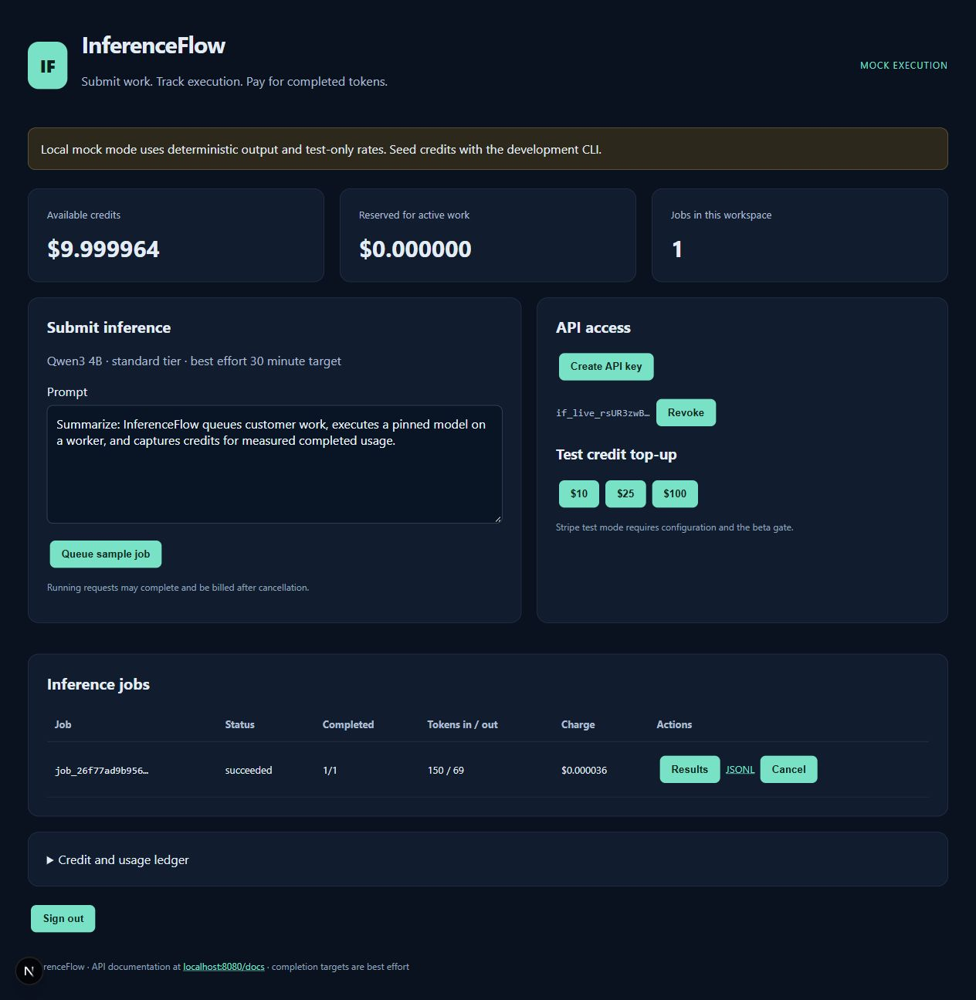

# InferenceFlow

Latest GPU result: [first real inference report](docs/validation/2026-10-25/real-inference-report.md). **110 real Qwen3-4B requests succeeded on one L4**: 10 requests in 7.98 seconds and 100 in 71.29 seconds, with clean usage/ledger audits and four active engine sequences observed. A transient HTTPS 502 killed the worker during the adaptive comparison; its 100 queued requests were canceled without charge. The 1,000-request test was not run. **NO-GO for public beta or savings claims.** Independent cleanup terminated the pod, a fresh GET returned 404, and no volumes remain. Provider cost is about **$0.11 estimated**, invoice pending; console credit remaining $9.88.

Independent cleanup: the protected `gpu-experiment` environment requires owner review and main only. The [exact-experiment watchdog](docs/github-cleanup-host.md) successfully removed both the [teardown trial](docs/validation/2026-10-25/teardown-validation.md) and subsequent inference pod through its cancellation finalizer. Both runs are finished and unarmed. Each new approved resource needs fresh price/budget/credential checks and an armed heartbeat. Automatic deadline/budget and provider-outage paths remain unproven on live resources.

[Download v0.3.0 prerelease and read the detailed release notes](https://github.com/manishklach/InferenceFlow/releases/tag/v0.3.0).

## October 24 local backend validation (historical)

An isolated Docker backend and temporary HTTPS connection passed **14 mock checks**, including 10 completed requests, outbound worker authentication, idempotency and ledger reconciliation. The complete backend suite passed **128 tests with 1 real-GPU test skipped**; the targeted safety/readiness suite passed 23 tests. The [reusable local rehearsal](docs/local-backend-rehearsal.md) generates private credentials only under ignored `.runtime/`, blocks development login/payment routes, and supervises automatic shutdown. See the [dated report](docs/validation/2026-10-24/local-backend-report.md). A subsequent [genuine staging OIDC login](docs/validation/2026-10-24/staging-auth-report.md) passed with owner-restricted access, a protected wallet read and zero reconciliation drift. Those were the preparation blockers at that date; the October 25 reports above record real-mode staging and successful live teardown. This rehearsal used mock inference; no GPU inference performance or cost advantage is claimed.

## October 23 readiness validation (historical)

**NOT READY — BLOCKERS REMAIN.** Final local validation: **113 tests passed, 1 real-GPU test skipped**. See [the complete live-site, scheduling, provider and GPU approval report](docs/validation/2026-10-23/readiness-report.md), [website screenshots and issue register](docs/validation/2026-10-23/website-report.md), [provider architecture](docs/architecture/providers.md), [first-GPU economics](docs/economics/first-gpu-economics.md) and [future private-alpha checklist](docs/releases/private-alpha-checklist.md). At that date, website fixes awaited publication and real GPU inference, savings, remote staging and independent cleanup were unverified; no paid GPU had been created. Current evidence is linked at the top of this README.

Private experimental real mode now has a separate `REVIEWED_GPU_EXPERIMENT_ENABLED` gate; public beta, Stripe and auto provisioning remain off. Worker metrics include cumulative engine tokens, overlap/idle and hardware memory. Provider selection remains simulation-only; optional providers cannot create/terminate or execute. Customer wallet/settlement algorithms are unchanged.

**Submit inference batches. Track execution. Pay for completed tokens.**

A prepaid asynchronous text-inference platform built with FastAPI, PostgreSQL, a durable scheduler, outbound GPU workers, vLLM, and Next.js.

[Quickstart](#quickstart) · [Architecture](#architecture) · [API and SDK](#api-and-sdk) · [Testing](#testing-and-validation) · [GPU deployment](docs/gpu-deploy.md) · [Release notes](docs/releases/v0.3.0.md)

> **MVP prerelease:** mock execution, staging OIDC, live L4 baseline inference/accounting and independent provider teardown have passed validation. GPU reconnect/recovery, matched policy comparisons, 1,000-request completion, external payments and sustainable economics remain unvalidated. Limited measured performance is in the dated real-inference report; no pricing advantage or production-readiness claim is made.

## v0.3 on main: sub-hour scheduling

The [multi-provider and batching readiness report](docs/microbatching-readiness.md) distinguishes implemented/tested behavior and provides the manual comparison procedure. Worker overlap traces, engine metrics, four-slot limits, read-only billing audits and optional-provider discovery contracts are included. **Runpod remains the only selectable execution provider; optional paid mutations, automatic failover and provisioning remain disabled.** The October 25 L4 test measured four active sequences and sub-hour completion for two baseline stages only; adaptive benefits, larger-load reliability and cost advantage remain unproven.

V0.3 adds an **opt-in 60-minute best-effort objective**, explicit admission predictions, adaptive concurrency, recommendation-only capacity planning, and internal GPU economics. It preserves the existing queue, worker fences, idempotency and wallet ledger. [PR #3](https://github.com/manishklach/InferenceFlow/pull/3), the engineering blog and readiness pull requests are merged into `main`. No paid capacity or public deployment is activated. The v0.3.0 prerelease identifies its original source snapshot; subsequent merged fixes do not move that release tag.

- [Scheduler architecture and gap analysis](docs/architecture/scheduler-v2.md) · [editable Mermaid diagram](docs/architecture/scheduler-v2.mmd)
- [Simulation comparison](docs/performance/simulation-results.md) · [raw seeded results](docs/performance/simulation-v0.3-seed42.json) · [real-GPU experiment plan](docs/performance/benchmark-plan.md)
- [GPU unit economics](docs/economics/unit-economics.md) · [product objective and limits](docs/product/60-minute-inference.md)
- [Why we're building InferenceFlow](docs/blog/why-we-built-inferenceflow.md) · [v0.3 release notes](docs/releases/v0.3.0.md)

Apply migration 0006 and restart API/scheduler/worker together. To try v2 locally, add the following to `.env` before starting Compose or the native services:

~~~dotenv
SCHEDULER_V2_ENABLED=true
ADAPTIVE_DISPATCH_ENABLED=true
DEFAULT_COMPLETION_TARGET_SECONDS=3600
ESTIMATOR_CALIBRATED=false
PROVISIONING_ENABLED=false
STRIPE_ENABLED=false
~~~

Both new flags default **false**. Disabling them restores prior scheduling/default-target behavior; existing accepted targets and rates remain intact. Missing mock GPU telemetry conservatively limits adaptive dispatch to two slots. vLLM retains token-level continuous batching.

New submissions return `admission` with best-effort outcome, estimated duration (or unknown), calibration status, source and reasons. Set `admission_policy="reject_if_at_risk"` to receive an actionable 503 **before credit reservation** if the requested target cannot be confidently supported. Uncalibrated estimates cannot satisfy strict admission. This is not an SLA.

The dashboard shows tenant queue/risk/latency/attainment measures. Its separate operator panel requires the metrics credential for capacity, GPU activity, cost and margin reports; tenant credentials cannot read other customers' data. The same report is available to trusted operators via `python -m packages.common.cli scheduling-report`. Quotes, invoices, sampled activity, mock data and missing coverage are distinguished.

Run reproducible offline experiments without a GPU or database:

~~~bash
python -m scripts.benchmark_scheduler --seed 42 --count 240 --output .runtime/benchmark-v03.json
~~~

The [implementation report and file manifest](docs/implementation-v0.3.md) records validation and remaining work. [View the unmodified scheduling dashboard capture](docs/media/v03/scheduling-full.png).

The six-scenario comparison is synthetic: some changes regress some metrics. Actual GPU throughput, sub-hour reliability, model fit and cost advantage still require approved hardware and provider invoices. Follow the [benchmark plan](docs/performance/benchmark-plan.md) before real-GPU calibration or spending.

## First real GPU experiment — baseline passed, recovery blocked

See the [October 25 results, evidence, failure analysis and cleanup proof](docs/validation/2026-10-25/real-inference-report.md). Preparation history below is not a current quote or permission to create another pod.

For the current six-run baseline/adaptive 10/100/1,000 comparison and optional worker-interruption gate, follow [the readiness report](docs/microbatching-readiness.md#first-manually-approved-runpod-comparison-exact-sequence). Its policy-verified instructions supersede the earlier single-policy sequence. Customer wallet/rate/settlement behavior is unchanged; physical inference may retry while customer usage/capture must remain unique. All new real-mode commands require explicit approval, valid private credentials and independent provider teardown within the $10 ceiling.

**Original selection:** [RTX 4090 Community](docs/rtx4090-community-experiment.md) had no available capacity at its historical $0.34/hour quote. Subsequent explicit approval used an L4 Secure pod at $0.59/hour GPU plus $0.011/hour temporary disk. The pinned model initialized with context 10,240 and four resident sequences. Historical proposals are superseded by the October 25 results. Gated tools remain in `scripts/gpu_experiment.py`; no wallet/billing implementation changed.

The [first-GPU runbook](docs/first-gpu-experiment.md) records the repository review, dated RunPod stock/price snapshot, pinned model/container checks, worker connection instructions, staged 10/100/1,000-request test plan, measurement definitions, budget controls and complete termination procedure.

The October 23, 2026 snapshot recommended one Secure Cloud **L40S 48 GB at $1.09/hour compute** because the final reads showed no L4 or RTX 4090 stock. This is a historical quote, not reserved capacity or a verified performance-per-dollar advantage. Price, stock and placement must be checked again before any approved creation.

Review the [proposed RunPod v2 payload](infra/first-gpu/runpod-pod.proposed.json), [in-Pod launcher](infra/first-gpu/launch.sh), and [control-plane environment overlay](infra/first-gpu/control-plane.env.example). They request one GPU, 80 GB ephemeral disk, no persistent volumes and no exposed inbound ports. Keep `PROVISIONING_ENABLED=false` and `STRIPE_ENABLED=false`. Replace connection/credential placeholders securely only after approval; never commit a rendered credential-bearing payload.

The ceiling remains **$10 all-in and 120 minutes maximum**; RunPod does not guarantee this experiment cap. Both approved L4 pods were removed, with the inference attempt lasting about 11 minutes. Transient reconnect, restart-idempotent bootstrap and durable telemetry export are now observed blockers for another experiment. Live payments remain disabled and untested.

Previous full-suite validation reached 162 passing tests with one gated GPU pytest skipped. The real GPU loader and read-only audits were executed separately on October 25; their results do not imply that every GPU or recovery scenario passed.

## What it does

Customers submit independent chat-generation requests, receive a job ID immediately, and retrieve ordered results while the platform owns queueing, execution, recovery, metering, and prepaid accounting. Workloads include document extraction, classification, enrichment, summaries, and synthetic-data batches that tolerate asynchronous completion.

| Area | Included |
|---|---|
| API | 1–100 requests/job, idempotency, partial results, pagination, JSONL, cancellation |
| Identity | OIDC code + PKCE/state/nonce, local sign-in, memberships, one-time API keys |
| Scheduling | Model affinity, weighted fairness/aging, deadlines, concurrency and KV-cache pressure caps |
| Workers | Outbound async agent, deterministic mock, private vLLM, canary, lease recovery |
| Accounting | Integer micro-USD, immutable ledger/rates, atomic capture/release, audited reconciliation |
| Payments | Gated Stripe test Checkout, verified webhooks, deduplication, refunds, dispute freeze |
| Callbacks | Registered HTTPS, HMAC, IP pinning, SSRF/rebinding protection, durable retries |
| Operations | Provider kill switch/caps, watchdog, Prometheus, optional OTLP, content retention |
| Tools | Next.js dashboard, Python SDK, OpenAPI, Compose, CI, tests and runbooks |

## Live showcase

[Open the deployed InferenceFlow Site](https://inferenceflow-execution.abc123xyza.chatgpt.site/) — currently owner-private. Making this repository public does not grant access to the hosted Site.

The responsive showcase includes an interactive execution replay, seven actual dashboard captures, Python/cURL integration examples, and downloadable evidence. Its [complete static source](sites/inferenceflow/) is included here. The replay uses recorded mock data; the Site does not host the API, database, GPU workers, or payment services.

Preview the Site locally from the repository root:

~~~bash
python -m http.server 8093 --bind 127.0.0.1 --directory sites/inferenceflow/dist
~~~

Open http://127.0.0.1:8093. Hosting identity is preserved in `sites/inferenceflow/.openai/hosting.json`; pushing to GitHub does not automatically redeploy Sites.

## Watch the execution flow

The [recorded walkthrough](docs/execution-walkthrough.md) follows sign-in → prepaid reservation → queued job → worker execution → results → metering and billing, with seven real browser captures, the actual SDK/JSONL evidence, integration diagrams, and commands to reproduce it locally. An [interactive screenshot player](docs/walkthrough.html) is included (serve `docs/` locally to play it).

This local recording completed four requests and canceled one: 124 microUSD total synthetic charge, zero remaining reservations/debt, and no reconciliation drift. It used seeded credits and mock inference; no GPU capacity or Stripe payments were used. The guide separately explains real GPU, OIDC, Stripe and callback integration.

## Quickstart

Requires Git, a running Docker Engine with Compose v2, and free local ports **3000**, **8080**, and **55432**. Mock mode requires no GPU or external service account.

~~~bash
git clone https://github.com/manishklach/inferenceflow.git
cd inferenceflow
cp .env.example .env
docker compose up --build -d
docker compose exec api python -m packages.common.cli seed
~~~

PowerShell users can copy the environment template with:

~~~powershell
Copy-Item .env.example .env
~~~

The seed command creates **developer@example.local**, adds **$10 in test funds**, and prints a new API key once. Funding is idempotent for its default reference: rerunning creates another key without duplicating that funding entry. Store the displayed key securely.

| Service | URL |
|---|---|
| Dashboard | http://localhost:3000 |
| Interactive API docs | http://localhost:8080/docs |
| OpenAPI | http://localhost:8080/openapi.json |
| Readiness | http://localhost:8080/readyz |
| Metrics | http://localhost:8080/metrics (requires METRICS_TOKEN bearer credential) |

Sign in as developer@example.local, submit a sample, and inspect tokens, charges, results, and ledger. Local outputs start with **MOCK**; rates are test fixtures.

### Prove the complete flow

~~~bash
docker compose exec api python scripts/docker_smoke.py
~~~

This submits 100 requests over HTTP, waits for the separate scheduler/worker, retrieves results, and reconciles the ledger. Recorded result:

~~~json
{
  "completed": 100,
  "captured_micro_usd": 2500,
  "usage": {"input_tokens": 3690, "output_tokens": 6900},
  "ledger_drift": 0
}
~~~

The charge is **$0.002500 at synthetic test rates**, not a public service price or GPU cost measurement.

~~~bash
docker compose logs --tail=100 api scheduler callbacks worker
docker compose down
docker compose up -d
~~~

Stopping preserves the PostgreSQL named volume. Retain it to keep accounts, jobs, and accounting history.

## Audit fixes and upgrades

The [audit remediation guide](docs/audits/2026-10-22-remediation.md) describes all ten fixes, migration 0005, worker protocol changes, secret rotation, and remaining infrastructure validation. Existing deployments must stop old API/scheduler/worker processes, back up PostgreSQL, apply migrations, and restart all services together. Old worker enrollment credentials must be replaced for production. Run the new callback process as well as the scheduler.

Customer sessions and API keys now share a PostgreSQL-backed allowance of 120 requests per tenant per UTC minute across API replicas. Refunds/disputes freeze the account and cancel outstanding work without further customer capture; consumed reversed funds become journaled debt. Authenticated wallet responses include debt_micro_usd.

## Architecture

~~~mermaid
flowchart LR
    C[SDK / dashboard] --> A[FastAPI]
    A --> P[(PostgreSQL)]
    S[Scheduler] --> P
    W[Outbound worker] -->|poll / heartbeat / finalize| A
    W --> M{Execution mode}
    M --> L[Local mock]
    M --> V[Private vLLM / NVIDIA]
    ST[Stripe test Checkout] -->|verified webhook| A
    P --> H[Callback delivery worker]
    H --> CB[Signed customer callbacks]
    G[Independent watchdog] --> R[GPU provider]
~~~

PostgreSQL provides durable work and transactional SKIP LOCKED leases. The worker keeps one model warm and calls vLLM concurrently so the engine performs continuous batching.

1. Validate the batch, count tokens, snapshot rates, and atomically reserve the maximum charge.
2. Assign a lease with an increasing fencing epoch; perform inference outside DB transactions.
3. Accept finalization only from the current worker/epoch with a valid lease.
4. Atomically persist output/usage, capture once, and release unused funds.
5. Recover abandoned work with bounded retries/backoff and reject stale completion.

**Execution is at least once; accounting is exactly once.** Crashes can repeat physical inference, but fencing and unique accounting references prevent repeated capture.

~~~mermaid
stateDiagram-v2
    [*] --> queued
    queued --> leased
    leased --> running
    leased --> queued: lease recovery
    running --> queued: retryable failure
    queued --> canceled
    leased --> canceled
    queued --> expired
    leased --> expired
    running --> succeeded
    running --> failed
    running --> billing_pending: inconsistent usage
    billing_pending --> succeeded: audited capture
    billing_pending --> failed: audited release
~~~

Targets are best effort. Unstarted work past target expires without capture. Running work can finish late, including after cancellation, and can be billed if its output is returned.

## API and SDK

Customer calls use a Bearer API key. Submissions also require an Idempotency-Key header. Dashboard and worker authentication are separate.

| Method | Endpoint | Purpose |
|---|---|---|
| GET | /v1/models | Revision, limits, rates, mode |
| POST / GET | /v1/jobs | Submit batch / list history |
| GET | /v1/jobs/{id} | Progress, usage and accounting |
| GET | /v1/jobs/{id}/results | Ordered paginated partial results |
| GET | /v1/jobs/{id}/results.jsonl | Authenticated download |
| POST | /v1/jobs/{id}/cancel | Best-effort cancellation |
| GET | /v1/wallet, /v1/wallet/transactions | Balances and ledger |
| POST / GET / DELETE | /v1/keys and /v1/keys/{id} | Dashboard-only key management |
| POST | /v1/webhook-destination | Register callbacks |
| POST | /v1/billing/checkout-session | Gated test top-up |

Sample payload: [examples/request.json](examples/request.json).

~~~bash
export INFERENCEFLOW_API_KEY='<key from seed or dashboard>'
curl -X POST http://localhost:8080/v1/jobs \
  -H "Authorization: Bearer $INFERENCEFLOW_API_KEY" \
  -H 'Content-Type: application/json' \
  -H 'Idempotency-Key: example-job-001' \
  --data-binary @examples/request.json
~~~

HTTP 202 returns a job ID and reservation. A repeated key/body returns the same job; a changed body under that key returns 409. See [API contract](docs/api.md) and [OpenAPI export](docs-openapi.json).

The SDK is included here; no PyPI publication is claimed. Create/activate a virtual environment, then install:

~~~bash
python -m pip install -e '.[dev]'
~~~

~~~python
import os
from packages.python_sdk import InferenceFlowClient

with InferenceFlowClient(os.environ["INFERENCEFLOW_API_KEY"]) as client:
    job = client.create_job(requests=[{
        "custom_id": "doc-001",
        "messages": [{"role": "user", "content": "Summarize this document."}],
        "max_output_tokens": 128,
    }], tier="economy")
    print(client.wait_for_job(job["id"], timeout=300))
    print(client.get_results(job["id"]))
    print(client.get_wallet())
~~~

The client generates idempotency keys and retries transient failures. It also supports catalog/status/cancellation. The batch example submits 100 requests:

~~~bash
python examples/batch.py
~~~

## Billing and defaults

Money uses integer micro-USD: USD 1 = 1,000,000 units. Rates are per million tokens and snapshotted at acceptance.

~~~text
reserve = ceil(prompt_tokens × input_rate / 1,000,000)
        + ceil(max_output_tokens × output_rate / 1,000,000)
capture = ceil(engine_input_tokens × input_rate / 1,000,000)
        + ceil(engine_output_tokens × output_rate / 1,000,000)
release = reservation − capture
~~~

Missing/inconsistent usage enters billing_pending, holds its reservation, and requires audited reconciliation; no customer charge is guessed. Failed attempts cost the operator without a customer token charge. Refunds/disputes freeze affected accounts and audit shortfalls.

| Default | Limit |
|---|---|
| Requests/job / body | 1–100 / 5 MiB |
| Prompt / output tokens | 8,192 / 2,048 |
| Pending / in-flight per tenant | 2,000 / 16 |
| Lease TTL / attempts | 60 seconds / 3 |
| Standard / economy target | Legacy: 30 minutes / 24 hours; opt-in v2: configurable 60 minutes, best effort |
| Content retention / GPUs | 7 days / 1 active GPU |

Read [billing invariants and reconciliation](docs/billing.md) before enabling payments.

## Configuration and real integrations

Copy [.env.example](.env.example); keep .env out of Git.

| Setting | Purpose / safe default |
|---|---|
| DATABASE_URL | PostgreSQL; Compose overrides its internal host |
| SECRET_KEY | Dashboard/PKCE signing only; replace development value before deployment |
| EXECUTION_MODE | mock locally, vllm for attached capacity |
| MODEL_REVISION | mock-v1 locally, exact reviewed SHA in real mode |
| WORKER_BOOTSTRAP_TOKEN | Separate worker credential; rotate before deployment |
| PROVISIONING_ENABLED | **false** |
| MAX_ACTIVE_GPUS | **1**, including creation intents |
| MAX_DAILY_GPU_SPEND_USD | Quote-based ceiling, initially **25** |
| STRIPE_ENABLED / PUBLIC_BETA_ENABLED | **false** / **false** |
| OIDC_* | Provider/client, issuer/audience, redirect settings |
| OTEL_EXPORTER_OTLP_ENDPOINT | Optional collector; install the observability extra first |

Follow [GPU deployment](docs/gpu-deploy.md) for pins, private vLLM, outbound worker, TLS/network isolation, smoke/restart testing, and shutdown. See [model/image lock](infra/model-lock.json).

~~~bash
# Downloads only the pinned tokenizer; no weights or rental.
python -m pip install -e '.[gpu]'
python scripts/check_tokenizer.py
~~~

Real GPU testing requires approved spending and attached infrastructure. RUN_GPU_E2E=1 opts in after configuration. Stripe stays test-only and grants credits only from verified paid webhooks. Managed OIDC validates PKCE/state/nonce/signature/issuer/audience/expiry. Development sign-in and seeding stay local-only.

## Testing and validation

| Check | Recorded result |
|---|---|
| v0.3 native PostgreSQL suite | **78 passed; 1 GPU test skipped** |
| Existing platform suite with v2 enabled | **31 passed** |
| Pre-v0.3 audit baseline | **56 passed; 1 GPU test skipped** |
| Earlier v0.1.0 Python 3.12 Docker suite | **32 passed; 1 GPU test skipped** (before audit fixes) |
| Native + Docker 100-request HTTP smoke | Succeeded; zero ledger drift |
| Ruff / mypy | Passed |
| Dashboard build / TypeScript | Passed |
| npm production audit | Zero reported vulnerabilities at validation time |
| Exact real tokenizer | Loaded; checked prompt counts 18 tokens |
| GPU / external service integration | Pending |

Coverage includes auth, isolation, idempotency, ordering, concurrent reserves/submissions/finalizers, rounding, immutable ledger, crash recovery, stale epochs, retries, partial success, cancellation, deadlines, signed payments, OIDC, SSRF/rebinding/redirects, callbacks, logging, limits, retention, migrations, and KV-cache pressure.

~~~bash
# Create once; skip if this dedicated test database exists.
docker compose exec postgres createdb -U inferenceflow inferenceflow_test
docker compose exec api python -m pytest -q
docker compose exec api python -m ruff check .
docker compose exec api python -m mypy apps packages
docker compose exec api python -m packages.common.cli reconcile
~~~

Tests apply migrations and truncate only a separate database ending _test. TEST_DATABASE_URL customizes its connection. PostgreSQL is required; SQLite is not used to approximate locking.

For native checks, install the dev extra, then run make test lint typecheck or the matching python -m commands. Build the dashboard separately:

~~~bash
cd apps/dashboard
npm ci
npm run build
~~~

## Native development

Requires PostgreSQL 16, Python 3.12 (3.11 development compatibility), Node.js 22 and npm. Create/activate .venv, copy the environment template, and configure DATABASE_URL.

~~~bash
python -m pip install -e '.[dev,gpu]'
python -m alembic upgrade head
python -m packages.common.cli seed
~~~

Run in separate terminals from the root:

~~~bash
python -m uvicorn apps.api.main:app --host 127.0.0.1 --port 8080
python -m apps.scheduler.main
# In another terminal:
python -m apps.callbacks.main
# Start after API readiness succeeds:
python -m apps.worker.main
~~~

In another terminal run npm ci and npm run dev from apps/dashboard. The temporary native smoke harness starts its own API/scheduler/worker and cleans them up; run it with ports free:

~~~bash
python scripts/local_demo.py
~~~

## Operations and troubleshooting

- **Docker connection:** start your engine/Desktop and verify docker info.
- **Occupied ports:** stop native previews before normal Docker deployment.
- **No credits:** use the exact seeded email or seed the intended development account.
- **Queued work:** inspect logs, readiness, revisions, heartbeats and KV-cache pressure.
- **Billing pending:** follow [audited procedures](docs/billing.md); never edit ledger rows.
- **Monitoring:** enable the observability Compose profile; Prometheus is at http://localhost:9090. See [alerts](infra/alerts.yml).
- **Traces:** install the observability extra, configure an OTLP HTTP collector, restart API.
- **GPU leaks:** use an independent watchdog, dedicated account and provider-side limits/alerts. Control-plane ceilings cannot guarantee billing stops during outages.

## Repository and documentation

~~~text
apps/api/                 FastAPI and OIDC
apps/scheduler/           Dispatch, recovery, callbacks, watchdog
apps/worker/              Agent, mock/vLLM engines, telemetry
apps/dashboard/           Next.js + TypeScript interface
packages/common/          DB, auth, ledger, providers, metrics
packages/python_sdk/      InferenceFlowClient
migrations/               Alembic revisions
infra/                    Dockerfile, model pins, Prometheus
scripts/                  Smoke tests and tokenizer check
tests/                    API, accounting, concurrency, security, migrations
examples/                 SDK example and API payload
docs/                     Contracts, deployment, runbooks, release notes
~~~

- [Implementation evidence and boundaries](IMPLEMENTATION_STATUS.md)
- [Architecture](docs/architecture.md), [API](docs/api.md), [OpenAPI](docs-openapi.json)
- [Billing](docs/billing.md), [GPU deployment](docs/gpu-deploy.md), [security](docs/security.md), [operations](docs/ops.md)
- [Internal pricing experiment](docs/pricing-experiment.md)
- [Changelog](CHANGELOG.md) and [release notes](docs/releases/v0.2.0.md)
- [Product specification](inferenceflow_mvp_spec.md) and [implementation brief](codex_inferenceflow_prompt.md)

## Scope and launch gates

One model is enabled. The optional second model, learned throughput prediction, organization UI, and automatic invoice ingestion are outside this implementation. Reservations/idempotency/leases are consolidated into durable rows; encrypted PostgreSQL columns replace object storage.

Before limited prepaid beta, validate GPU inference/recovery, actual OIDC/Stripe/provider flows, callback TLS/egress, backups, measured margins, model licensing, and security/legal/accounting requirements. Mock results and synthetic rates do not establish GPU performance or savings.
