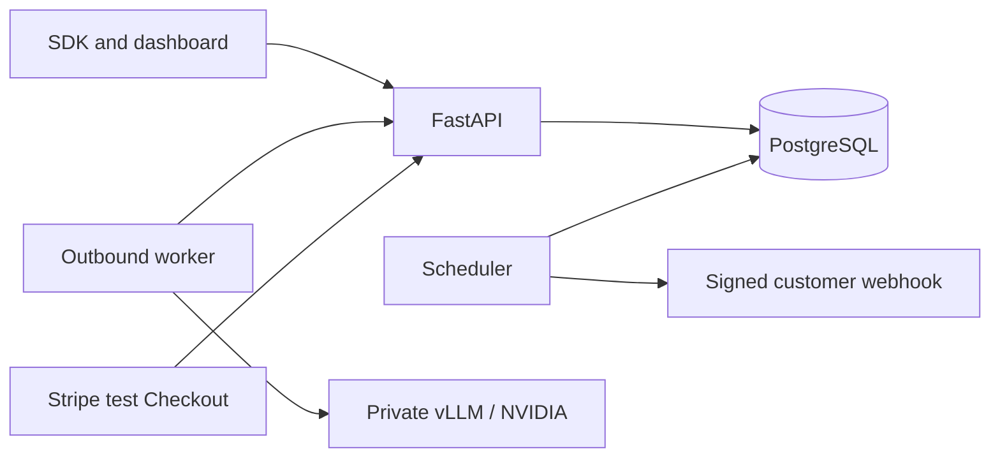

# Architecture and decisions
The product specification takes precedence. No material requirement conflict was found. This implementation combines per-request reservations into `job_requests` and embeds idempotency records in `jobs`; a UNIQUE tenant/idempotency key and canonical hash enforce the contract. Jobs retain idempotency beyond 24 hours. The initial deployment supports one model and one GPU. Users and owner memberships map OIDC subjects to tenants. Model revisions and immutable rate versions are persisted and linked to every request. Short prompts/results live encrypted in PostgreSQL rather than a separate object store.

Submission validates the entire batch before creating work, counts chat-template tokens, snapshots rates, locks the tenant wallet, reserves credit, and commits durable queued requests. Local mock tokenization counts bytes of an explicit template, never represents itself as the real model tokenizer. Real mode loads `AutoTokenizer` at an exact SHA with `trust_remote_code=False` and `enable_thinking=False`.

Scheduler uses a transaction-scoped advisory lock and `FOR UPDATE SKIP LOCKED`, serializes wallet mutations before request locks, recovers expired leases, expires unstarted targets, then assigns model-compatible warm workers within tenant and worker caps. Priority weighting, age and served counts provide a scheduling foundation; this is not a throughput prediction system. Inference runs outside DB transactions. vLLM does continuous batching.

States: queued -> leased -> running -> succeeded/failed/canceled/expired. Retryable failures and expired leases return to queued with exponential backoff, maximum three attempts. A missing/inconsistent engine usage report enters `billing_pending`, retains reservation, records an audit event and requires reconciliation. Running targets can finish late. Canceling running work is best effort and valid returned outputs can still be charged.

Finalization locks the wallet then request, checks worker ownership, lease epoch, state and expiry, and atomically persists encrypted output, unique usage, capture and release. Duplicate physical execution after a crash is possible; duplicate billing is fenced. Ledger UPDATE/DELETE is blocked by a PostgreSQL trigger. Tenant predicates protect public resource reads and actions.

Current limitations and deliberately consolidated schema are listed in IMPLEMENTATION_STATUS.md. Do not infer launch readiness from local tests.
