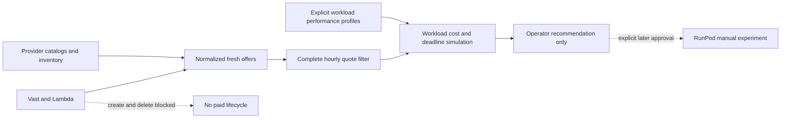

# Provider architecture and activation boundaries

RunPod is the only execution-selectable provider. No automatic provisioning, price routing or provider failover is enabled. Existing lifecycle interface in packages/common/providers.py: list_instances,get_instance,get_price_quote,create_instance,terminate_instance, using GpuSpec. The manually reviewed experiment payload remains safer than the generic automatic create path: it pins image, cloud, CUDA floor, private ports, model/context and startup.

packages/common/provider_discovery.py adds optional read-only discovery to that interface. Offers preserve provenance/time, exact cents/Decimal-to-microUSD conversion, per-instance GPU count and optional hardware (VRAM MiB, host CUDA, architecture). Missing hardware/storage/ancillary terms remain unknown. RunPod normalizes memory from catalog GiB to MiB; Vast gpu_ram is vendor-reported MiB, cuda_max_good is capability metadata rather than a running kernel test; Lambda may omit per-GPU VRAM, so it is not invented from names. Optional instance_state maps inventory booting/running/stopped/unhealthy/terminating, preserves unknown raw state and never equates running with inference health. Application health probes and active execution for Vast/Lambda remain unimplemented.

| Capability | RunPod existing lifecycle | RunPod discovery wrapper | Vast / Lambda optional |
|---|---|---|---|
| Inventory/status | Implemented v2, mocked | Paginated read | Authenticated inventory/read contracts, mocked |
| Quote/hardware/stock | Raw catalog, confirm terms manually | Normalized offer, explicit Community/Secure | Vast offer search / Lambda instance types + regional stock |
| Storage/ancillary cost | Manual confirmation/accounting | Unknown until confirmed | Unknown until confirmed; never defaultzero |
| Create/termination | Creation gated; tracked-only watchdog cleanup | Blocked | Explicit blocked stubs before HTTP |
| Real engine health | Separate vLLM canary/worker | Not supplied | Not implemented |
| Failure recovery | Worker leases/epochs plus provider watchdog | Sanitized bounded read retry | Sanitized bounded read retry, no fallback execution |
| Cost accounting | Existing instance/invoice metadata, not customer wallet | Recommendation only | Simulation only |

ReadOnlyProvider permits fixed inventory/catalog paths and Vast's documented read-only POST search. At most two read attempts for transport/429/502/503/504; auth/schema/redirect errors fail, no response bodies or secrets in errors. Authentication uses secure bearer headers. Real credentials are not needed by contract tests. There are no Vast/Lambda runtime credentials or paid instances configured by this work.

compare_offers is only a fresh complete hourly quote prefilter. provider_selection.compare_workload is a separate offline simulator: full rental+storage+ancillary quote, immutable-model compatibility, explicit input/output throughput profile, startup time, current stock, reliability allowance and deadline slack. Predicted service time is conservative serial prefill+decode; reliability is an assumed retry multiplier, not an empirical guarantee. Unknown/mismatched inputs exclude an offer. More expensive per-hour hardware can win on estimated workload cost. Simulated profiles carry a provenance/reference and real/synthetic bit. Neither comparison performs network calls or changes active_provider. Calibration and real heterogeneous worker routing are future work.

## Verified sources — October 23, 2026

- [Vast official offer search](https://docs.vast.ai/api-reference/search/search-offers): POST https://console.vast.ai/api/v0/bundles, on-demand filters. Provider documentation examples and response shapes are not a successful authenticated live test. Launch would use PUT /asks/{offer_id}/; adapter deliberately blocks it. Do not rent while implementing discovery.
- [Lambda official Cloud API](https://docs.lambda.ai/api/cloud): Bearer auth, GET /api/v1/instance-types and /instances; prices are cents per INSTANCE hour, specs.gpus can exceedone; regions_with_capacity_available is the actual regional list. Launch /instance-operations/launch and terminate /instance-operations/terminate are documented future interfaces, deliberately blocked. Per-second account rate limits still need a production centralized limiter before optional adapters are operationalized.
- [RunPod v2 contract](https://api.runpod.io/v2/openapi.json). Existing read adapter is preserved; no migration/rewrite or AMD promise is made.

Deterministic tests: tests/test_provider_discovery.py, tests/test_readiness.py. Remaining work: live credentialed read contracts, explicit all-in costs, quota/rate governance, application health, approved lifecycle/placement and measured model-specific profiles. No optional provider is production-ready.
