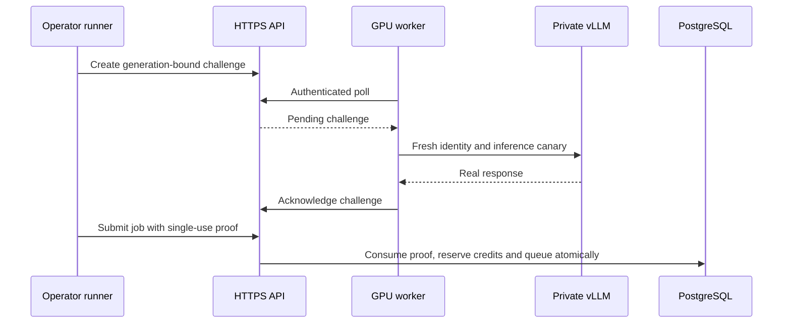

# Second GPU experiment — October 25 independent review

Execution update: [measured second-experiment report](../validation/2026-10-25/second-gpu-report.md). The bounded run has ended and the pod is terminated. 410 requests succeeded; 1,000 requests were not admitted after a local staging-supervision failure. The preparation below is retained as the original protocol, not a statement that the run is still pending.

**Preparation only. No second inference pod has been created.** Public beta, live Stripe and automatic provisioning remain disabled. This plan validates execution and economics; it does not introduce extraction features or alter wallet/rate/settlement algorithms. Root LICENSE remains undecided.

## Diagnosis before the readiness change

The first run's loader checked `/internal/scheduling/report` before posting its job. That report used a cached heartbeat/telemetry timestamp. At 08:12:13 UTC a transient HTTP 502 during a CPU API policy restart killed the worker, yet the loader briefly saw its earlier heartbeat as fresh and admitted 100 requests. Best-effort admission allowed acceptance without a currently executing worker. The scheduler's 90-second liveness window could still lease work; lease assignment was not proof the GPU worker had polled or begun execution. This is a time-of-check/time-of-use race combined with coarse liveness and unhandled control-plane failure—not evidence that adaptive batching itself failed.

The [merged reconnect/bootstrap fixes](../validation/2026-10-25/recovery-fixes.md) retry temporary failures with a 120-second wall-clock budget, preserve credentials/epochs, fail authorization errors, propagate fatal tasks and reuse a retained checkout. Deterministic tests cover lost finalization responses, stale fences and exactly-one customer capture. They passed locally and in CI; real GPU recovery remains unverified.

## Live readiness gate

New private experiment endpoints use the operator metrics credential to create a **30-second, single-use challenge bound to a specific worker generation**. The worker must retrieve it on its next authenticated poll, rerun its loopback engine identity/generation canary, then acknowledge with its worker credential. A cached heartbeat alone cannot complete the challenge.

For `REVIEWED_GPU_EXPERIMENT_ENABLED=true` with real vLLM mode, a new `/v1/jobs` submission requires `X-Experiment-Readiness`. The transaction locks the worker/proof and consumes a valid acknowledged proof before reserving credits. Missing, expired, consumed or old-generation proof returns 503 without reservation. Replay of an already accepted idempotency key still returns the existing job without consuming another proof. Concurrent distinct jobs cannot consume the same proof twice. Default mock/public API behavior remains unchanged; these operator endpoints are unavailable when the private experiment gate is off.

This proves a recent authenticated poll and engine canary, not GPU attestation or guaranteed future availability. A worker can still fail immediately afterward. Existing epoch/generation fencing, lease expiry, retry recovery and independent cleanup remain necessary. Only trusted worker software asserts the canary succeeded. Each extra canary consumes GPU time/tokens and belongs in infrastructure cost, not customer usage.



## Dispatch timing

Migration `0007` adds nullable operational timestamps and per-attempt worker durations; historical records are not backfilled with invented times. `scripts.audit_gpu_run` exports measured/missing counts and p50/p95/p99 for each component:

| Component | Measurement |
|---|---|
| Admission | HTTP middleware receipt → end of submission processing, including tokenization, checks and reservations |
| Scheduler not-before eligibility | Admission marker → initial not-before boundary, if later |
| Queue until scheduler observation | Eligible boundary → first scheduler observation of eligible queued work |
| Capacity/policy wait | First observation → selection/lease decision start |
| Lease assignment | Selection start → first assigned lease timestamp |
| Worker poll | First lease assignment → server handling of the worker poll/attempt |
| Execution-start delay | Worker-monotonic poll receipt → engine-call start, including readiness work in that response |
| Engine call | Worker-monotonic engine invocation → completion/error |

The first six components share server UTC and sum to ingress-to-first-poll when all observations exist. The admission marker precedes DB commit; commit-tail visibility is included in the following queue interval. Cross-host network/clock residual between server poll handling and worker receipt is **unknown**. Do not add unsynchronized wall clocks or claim worker-call timing is device-kernel time. First-dispatch components stay separate from subsequent retry attempts, epochs and engine costs. Submission-to-result and all-accepted deadline attainment remain authoritative overall outcomes.

## Cold start and full-lifetime coverage

Retain the pod-create request timestamp/monotonic duration, response `createdAt`, provider system logs, UTC container markers, one-second compact samples, worker traces, finalizer confirmation and fresh provider 404. New launcher markers cover container bootstrap, worker environment ready, model download start/end, engine launch and health readiness. Model acquisition uses the pinned revision explicitly before vLLM launch, with a 900-second download timeout; download duration includes metadata/cache checks. Engine readiness has its existing 900-second bound. Hardware sampling begins before model acquisition and engine initialization; unavailable Prometheus metrics are explicitly missing.

`scripts.experiment_phases.extract_events/cold_start` separates allocation/pull when provider markers exist and derives weight-load/compilation spans from the engine's reported durations anchored to provider log timestamps. Provenance identifies these derived spans. Engine initialization is an **inclusive** interval containing loading and compilation; do not sum it with its children. Missing allocation/pull boundaries stay unknown. Container bootstrap includes dependency setup. The old engine-start-to-health measure included download; the new explicit download phase changes that measure's meaning, so compare rental-to-health and phase definitions rather than treating the two engine timers as equivalent.

Full rented lifetime is create request/creation through verified termination, including cold start, canaries, idle, retries, unsuccessful work and cleanup. GPU utilization before the container can sample hardware remains uncovered unless provider observations are available. Preserve sample timestamps, zero readings and gaps; report covered/unknown seconds and time-weighted utilization on covered intervals. Never report an active-load sample mean as full-lifetime effective utilization.

During the first 10 requests require at least **90% valid compact engine + NVIDIA coverage** over API acceptance to last terminal result. `scripts.second_gpu_experiment coverage` deduplicates samples, rejects missing counters/hardware, caps hold intervals at 1.5 seconds, and counts gaps as unknown. Raw samples stay on disk; compact schema v1 avoids the previous 16 KiB histogram fragmentation. Log retrieval still must be checked before termination. If coverage fails, stop load; fix/export evidence rather than progressing to 100. Engine running/waiting sequences and worker overlap are separate observations; iteration-token histograms contain prefill and are not decode-only batch efficiency.

## Prepared matched workloads and sequence

```bash
python -m scripts.second_gpu_experiment prepare --output .runtime/second-experiment-NEW
```

This offline command creates smoke-10, comparison-100, comparison-1000, interruption-100 and a hash manifest. **All three 100-request arms read the same `comparison-100.json` bytes**, including custom IDs, short/medium mix and deterministic decoding. Only policy, tenant concurrency cap and idempotency run ID differ. Hashes prevent accidental workload drift. Prefix caching and thinking stay off. Use the same model revision/container, hardware, rates, cold/warm accounting conventions and stable staging configuration. Run order is a possible warmup/time confound; report it and repeat/reverse matched arms only if budget/time permit.

1. After approval and armed cleanup, verify private vLLM, exact identity, memory/context fit and the new live canary proof. Run 10 baseline requests; verify all succeed, usage/capture/reconciliation and compact coverage. Record admission/dispatch components, actual engine overlap and evidence export.
2. With no unresolved requests, run identical 100-request **sequential** (`v2=false`, adaptive=false, tenant cap=1), **baseline concurrent** (false/false/cap=4) and **adaptive concurrent** (true/true/cap=4) arms. Worker/engine hard cap stays four. Apply idle-boundary configuration changes under a supervised maintenance window, then require the new live canary; never rely on the previous heartbeat after restart. Estimator remains explicitly uncalibrated.
3. Separately run the opt-in `gpu-test-interruption` 100-request workload. The existing one-shot worker exit occurs after five engine successes before finalization; restart keeps vLLM alive. Verify expired/stale attempts, requeue, eventual results, one usage/capture per accepted successful request, released reservations, zero wallet drift and physical retry cost. Keep this fault arm out of clean throughput comparisons.
4. Only if every required earlier stage and audit passes, and predicted stage time plus cleanup reserve fits the remaining watchdog deadline/budget, run up to 1,000 requests. Prefer matched baseline/adaptive; a sequential 1,000 arm is optional and may not fit. Never substitute estimator predictions for the observed 60-minute result. Do not attempt every arm merely to exhaust $10.
5. Stop on critical errors, stale readiness, missing telemetry, invoice anomalies, billing drift or guard threshold. Cancel unresolved synthetic jobs using the existing API, reconcile, trigger independent termination, verify 404 and empty storage inventories, then export the final report.

Example after approved deployment, with tenant API key/control URL/metrics token supplied securely through environment:

```bash
python -m scripts.gpu_experiment run --execute --policy baseline --count 10 --run-id second-smoke --workload-file .runtime/second-experiment-NEW/smoke-10.json --output .runtime/second-smoke
python -m scripts.second_gpu_experiment coverage --samples PRIVATE_COMPACT.jsonl --start ACCEPTED_UTC --end LAST_TERMINAL_UTC --output .runtime/smoke-coverage.json
# Change to each corresponding idle-safe policy first; use different output/run IDs.
python -m scripts.gpu_experiment run --execute --policy sequential --count 100 --run-id second-sequential --workload-file .runtime/second-experiment-NEW/comparison-100.json --output .runtime/second-sequential
python -m scripts.gpu_experiment run --execute --policy baseline --count 100 --run-id second-baseline --workload-file .runtime/second-experiment-NEW/comparison-100.json --output .runtime/second-baseline
python -m scripts.gpu_experiment run --execute --policy adaptive --count 100 --run-id second-adaptive --workload-file .runtime/second-experiment-NEW/comparison-100.json --output .runtime/second-adaptive
python -m scripts.audit_gpu_run --run-directory PRIVATE_RUN --output PRIVATE_NEW_AUDIT.json
python -m packages.common.cli reconcile
python -m scripts.compare_gpu_runs --counts 100 --include-sequential --directories .runtime/second-sequential .runtime/second-baseline .runtime/second-adaptive --output .runtime/second-matched-100.json
```

These are instructions, not approval or executed GPU results. The private interruption prefix must be configured on the pod explicitly. A new output path is required each time; retries retain the same idempotency key. Preserve ambiguous submission evidence and do not create a replacement job under a new key.

## Previous posted bill and before/after

At 05:17 PDT October 25, the [RunPod day-bucket billing read](../validation/2026-10-25/posted-runpod-bill.json) reported the prior inference pod `w70ukczutth1b4` at **$0.1100844031**: GPU $0.1082325513 + disk $0.0018518518. The original quote-based estimate was $0.1103048984, a $0.0002204954 difference (~0.20%). Output-normalized posted provider cost is **$28.87/M successful output tokens** for 3,813 output tokens, including rented idle/startup/failure time. The teardown-only pod posted $0.0073656584; combined account cost for both is **$0.1174500615**. The API provides bucket records, not a finalization attestation or tax invoice. An earlier partial read understated this total and must not be reused. Console credit was $9.88; a new balance read is required at approval time.

| Evidence | First attempt | Second attempt |
|---|---|---|
| Baseline 100 completion | 71.294 s | Not executed |
| Baseline request p95 | 68.193 s | Not executed |
| Successful input/output | 39,888 / 3,813 across 110 requests | Unknown |
| Overall accepted completion within 60 minutes | 110/210 = 52.38%, including canceled arm | Unknown |
| Recovery | Worker exited on 502; adaptive arm canceled | Local fixes pass; GPU recovery pending |
| Readiness | Cached heartbeat snapshot | Challenge/canary/single-use admission implemented, not GPU-validated |
| Dispatch decomposition | Mostly unavailable historical timestamps | Instrumented; measurements pending |
| Full-lifetime utilization | Unknown; partial active-load samples | Coverage gate prepared; full lifetime still to measure |
| Provider cost | Posted $0.1100844 inference pod | Unknown |

Generate an honest pending comparison without supplying simulated after-data:

```bash
python -m scripts.compare_second_experiment --before docs/validation/2026-10-25/real-gpu-evidence/gpu-real-baseline-100.json --output .runtime/before-after.json
# Add --after ACTUAL_SECOND_BASELINE_AUDIT.json only after real execution.
```

Final report must include every arm, hardware/source/workload hashes, accepted and successful denominators, input/output throughput, p50/p95/p99 latency, dispatch components, queue depth, active sequences/overlap, covered GPU utilization, full rented lifetime, errors/retries, actual GPU/disk/ancillary charges, canary/failed-work overhead, cost per million successful output tokens, invoice/coverage gaps, ledger reconciliation, remaining credit and termination proof. Do not combine stage cost allocations with the same full bill twice. Compare like-for-like warm workloads separately from the fully loaded full-rental outcome.

## Approval boundary and decision

Proposed shape remains one manually created **L4 24 GB Secure Cloud** in a freshly available region, pinned Qwen3-4B and vLLM 0.8.5 digest, BF16, 10,240 context, four resident sequences, 80 GB ephemeral disk, no public ports/persistent storage/provider key on the pod. Recent quote: $0.59 GPU + $0.011 disk = **$0.601/hour**, about **$1.202 for two hours** before any unreported fees/tax; ceiling $0.65/hour. Refresh exact placement/quote before approval. The original experiment budget is $10 total; recorded prior spend $0.11745 leaves about $9.88255. New guard allocation remains $8, preserving the remainder for uncertainty; it is not a RunPod-enforced account cap.

Use the existing protected `gpu-experiment` GitHub environment and dedicated encrypted cleanup key, fresh exact ownership marker and fresh armed heartbeat **before** creation. Prior two cancellations independently terminated their exact pods and fresh GET returned 404. A new read-only credential preflight and owner review are required for the new run; earlier success is not a newly armed guard. The watchdog has a 110-minute termination threshold and final cleanup on cancellation/failure, with exact-ID operator fallback. Preserve at least ten minutes of cleanup headroom and stop admissions early enough to drain. Fully terminate rather than merely stop, then verify no retained disk/network/global volumes. PC-local supervision alone is insufficient.

**NO-GO for renting until final explicit approval, fresh secure staging login, migration/source validation and independent cleanup readiness.** The prior temporary tunnel/callback may expire and must be revalidated; no wildcard callbacks. **NO-GO for commercial launch or savings claims:** matched GPU recovery/load results, full coverage and viable equivalent-model unit economics are still absent. Conditional GO for the bounded engineering experiment only after those preflight/approval gates; a commercial GO additionally requires quality-matched hosted comparison and sustainable non-GPU costs. [Extraction customer hypotheses](../research/auditable-extraction-discovery.md) are research proposals, not new features or validated demand.

Local validation: 181 PostgreSQL-backed tests passed, one explicitly gated GPU test skipped; targeted readiness/timing/coverage and reconnect tests passed. Lint and mypy (36 source files) passed. The updated isolated staging host passed 15 HTTPS/security/tokenizer/reconciliation checks and its live API rejected a proof-less synthetic submission with 503 and an unchanged wallet. Migration 0007 is applied there. Auth0 login at the restarted tunnel and fresh independent cleanup owner review remain operational gates; no new GPU measurement is implied by local/CPU checks. Credentials and rendered private payloads remain outside Git.
