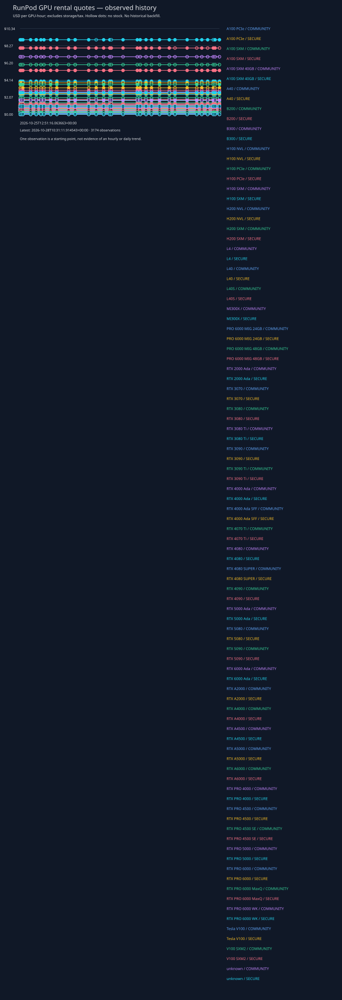

# GPU rental price observations

Hourly observations begin October 25, 2026. These are RunPod **GPU hardware** rental quotes, not language-model API token prices or measured Qwen inference costs.



- [Raw timestamped observations](observations.jsonl) preserve the queried cloud, GPU, CUDA floor, stock and data-center responses.
- [Hourly observation export](hourly.csv) contains actual observation times in UTC; a missed hour stays missing.
- [Daily summary](daily.csv) groups observations by UTC date with min/mean/max hourly quotes and stock counts. Means are sample averages, not time-weighted billing rates. A daily rental estimate would be hourly quote × 24, not a daily discount.

Scope: every GPU returned by RunPod’s catalog (48 hardware models in the first full snapshot), including NVIDIA and AMD; Community and Secure Cloud; one Pod GPU; no CUDA, memory or region filter. The initial three-model snapshot used a CUDA 12.8 floor; later full snapshots have a null floor and are not capacity-equivalent. Unsupported cloud entries remain catalog references, not rentable offers. Availability is a point-in-time catalog observation, not a reservation. No-stock quotes remain visible as hollow markers. Lines connect observations and do not establish prices between samples. The first snapshot alone cannot establish a trend.

Prices exclude disk, network volumes, tax and other ancillary charges. The experiment's separately verified 80 GB ephemeral-disk quote was $0.011/hour; do not silently apply it to every future deployment. Effective inference cost additionally depends on successful tokens, startup, utilization, idle time and retries.

Collection uses read-only RunPod MCP `list_gpu_types` for both clouds. Pass every returned GPU object, augmented with `cloud`, as a JSON array on standard input:

```powershell
Get-Content -Raw PRIVATE_SNAPSHOT.json | .\.venv\Scripts\python.exe -m scripts.gpu_rate_history
```

The renderer uses only the Python standard library and never contacts a provider or provisions resources. An hourly Codex follow-up is requested separately; local app/connector availability can cause missed observations. Charts and exports are local repository files until explicitly committed/pushed. No credentials belong in snapshots. The website GPU Hourly Rates page reads the public repository history, with a published snapshot fallback and explicit stale-data indicator. Local records must be pushed before they become visible through that feed. [Latest full catalog table](latest.md).
