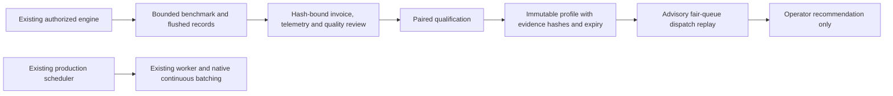

# Evidence-driven model throughput controller

Implemented October 27, 2026: a functional **offline/advisory** profiler, bounded direct-engine benchmark client, evidence qualification and dispatch replay. No live scheduler integration or throughput improvement is claimed. Existing worker, wallet, settlement, model defaults, provider adapters and safety flags are unchanged.

The [A40 comparison](../validation/2026-10-27/a40-hosted-1010-report.md) found adaptive dispatch slower; the [H100 follow-up](../validation/2026-10-27/h100-sxm-smoke-report.md) completed smoke only. Neither produces a newly qualified throughput profile. Synthetic demonstrations cannot qualify one.



## Working components

| Component | Implemented behavior |
| --- | --- |
| `packages/common/throughput.py` | Strict profile identities; repeated paired comparisons; bounded token-aware dispatch replay; baseline/pause fallback |
| `packages/common/throughput_benchmark.py` | Concurrent OpenAI-compatible HTTP calls to an existing engine; served-ID check; deadline/cancellation; per-request accounting and exact-reference checks |
| `packages/common/throughput_evidence.py` | Bind reviewed cost, quality and telemetry to an exact benchmark hash without changing its mode, token counts, identity or timings |
| `scripts/throughput_profile.py` | `demo`, `schema`, `benchmark`, `attach-review`, `qualify`, `replay`; no provisioning or engine-reconfiguration operation |
| `infra/throughput/deepseek-v41.proposed.json` | Pinned candidate model metadata; explicitly not deployable; missing runtime image/topology/evidence remain blockers |

## Identity and tuning boundaries

Profiles bind model and tokenizer commits, immutable engine image digest, precision, GPU type/count/interconnect topology, context limit and prompt/output bucket. `runtime_config_sha256` hashes **all invariant engine/deployment settings except the explicit Tuning fields**. Tuning separately records concurrency, resident-token budget, engine max-batched tokens and speculative draft length. Every field participates in the profile digest; changing a model, topology or invariant configuration invalidates reuse.

The resident-token budget is an admission limit on the sum of prompt tokens plus maximum output reservations, including active work. It is **not** vLLM's per-iteration `max_num_batched_tokens`, a KV-byte calculation or a claim that a MoE model fits in memory. Hardware fit requires a validated engine deployment and measured headroom.

Benchmark runs enforce client concurrency only. Declared engine batch/draft settings and resident-token budget require independently checked deployment evidence; the client does not silently change engine settings or attest actual weights. Its `/v1/models` check verifies the served ID, not a cryptographic model hash. The operator review binds evidence hashes, not independently authenticated invoices or hardware attestations. A dishonest operator can forge unsigned records; these tools do not solve that trust problem.

Requests in a replay are supplied in the existing scheduler's fair order. No new fairness algorithm, tenant mixing policy or prefix-cache sharing is installed. Replay respects hard capacity, active requests, resident-token reservations, per-tenant headroom and workload bounds. It does not bypass the production scheduler's locks, fencing, reservations, expiry or worker-readiness checks, because it never leases anything. Reported deadline risk is advisory, not a completion guarantee.

## Qualification and rollback rules

Defaults require at least **three matched pairs**, **100 requests per trial**, and **30 seconds measured request span**. Match exact workload/sampling hash, artifact/hardware identity and measurement scope. Each pair must have identical request counts. Duplicate run IDs, per-trial evidence hashes and pair records are rejected; failed repeats cannot simply be removed to manufacture a win.

Every trial must have real execution mode, all requests successful, known successful final-output tokens, no OOM, validated quality >=0.95, telemetry coverage >=90%, measured peak-memory fraction <=85%, and a reviewed full-rental invoiced cost. Warm estimates and missing invoices cannot qualify a profile. Across **every pair**, the candidate must improve successful output TPS by at least 20%, keep p95 within 10% of baseline, retain baseline quality and avoid a higher full-rental cost per million successful output tokens. These are qualification thresholds, not promised speedups or statistical confidence intervals. Use representative quality tests and balanced/randomized trial order; three repeats are an initial gate, not proof across workloads.

Profiles expire after at most seven days. Offline use additionally requires `--use-profile`; default replay uses baseline. Missing/corrupt/expired/future profiles or identity mismatch cannot expand concurrency. Missing, future or >10-second-old telemetry pauses admission because active/resident counts are unknown. Fresh errors, memory pressure or p95 regression revert recommendations to baseline. A last critical >=90% memory observation pauses even when stale. Static batch/draft mismatch requests reconfiguration; the tool does not apply it. If the fallback baseline also needs different engine flags, dispatch pauses rather than pretending a rollback happened.

No live feature flag was added: the production scheduler never imports these modules. An eventual integration needs a separate reviewed change, real profiles, atomic capacity accounting inside current scheduler locks, concurrency-race/fencing tests and an explicit enablement decision. The current worker still caps capacity at 16 even though offline engine studies can describe up to 128 clients.

## Run locally without a GPU

Run from the repository root; an installed editable package and development dependencies are required. Use a new output directory so prior evidence is preserved.

```bash
python -m scripts.throughput_profile demo --output .runtime/throughput-demo
python -m scripts.throughput_profile schema --output .runtime/throughput-schemas.json
python -m scripts.throughput_profile qualify \
  --input .runtime/throughput-demo/observations.jsonl \
  --baseline .runtime/throughput-demo/baseline.json \
  --output .runtime/throughput-demo/rechecked.json
python -m scripts.throughput_profile replay \
  --input .runtime/throughput-demo/scenario.json \
  --output .runtime/throughput-demo/replayed.json
python -m unittest tests.test_throughput_profiles -q
```

The demo is explicitly mock, performs no network calls and produces **no qualified profile**, even though synthetic candidate rates are higher. The schemas describe Study, Observation, Tuning, Replay, Review and Profile. Input files reject unknown fields, floating model revisions, boolean counts and non-finite metrics.

## Benchmark an existing, separately authorized engine

Prepare Study JSON from the exported schema: a reviewed Identity and Tuning, immutable served model ID, unique run/pair IDs, explicit `execution_mode`, sampling parameters, and request messages/output caps. Optional `expected_text` supplies a strict final-answer reference. Set `THROUGHPUT_ENGINE_KEY` securely in the local process environment; never pass credentials in URLs or commit study files containing private prompts.

```bash
python -m scripts.throughput_profile benchmark \
  --study .runtime/reviewed-study.json \
  --base-url http://127.0.0.1:8000 \
  --timeout 120 --execute \
  --output .runtime/trial-01.json
```

This sends real inference calls **only when explicitly executed**. It does not rent hardware, enforce a cloud budget, arm cleanup, enable DeepSeek in production or validate the InferenceFlow queue/billing pipeline. Existing paid capacity still needs independently approved spending/cleanup controls. Non-loopback origins require HTTPS; credentials/query strings/paths in origins are rejected, redirects and environment proxies are disabled. No command examples above provision anything.

Before network calls the client writes a nonsecret intent hash. Completed/failed/canceled request records are flushed to `trial-01.json.records.jsonl`; intent is in `trial-01.json.intent.json`. Existing intent or output cannot be silently replayed or overwritten, including after a summary is deleted. These are local process-failure diagnostics, not cross-host checkpoint/resume or exactly-once generation. HTTP failure is not retried automatically. Cancellation cannot guarantee remote engine work stopped; reconcile the engine and use the independent capacity cutoff.

Results contain output hashes, counts, quality outcomes and safe error types rather than plaintext prompts/answers, credentials or response bodies. Keep them private: supplied custom IDs can themselves contain sensitive information. Per-request completion latency includes client queueing; TPS divides successful final-output tokens by **whole request-cohort wall span**, not summed overlapping execution durations. Warmup/model-list checks and model startup are outside that request span; fully loaded cost must include them separately.

Reported generated tokens, reasoning tokens and final-output tokens are distinct. Missing reasoning-token detail stays unknown even when a response has no reasoning text; truncated/malformed responses do not count as successes. Unknown final counts cannot qualify a profile. Use a compatible backend with explicit accounting or separately validated observations from a pinned tokenizer pipeline; do not fabricate zero reasoning tokens. The built-in quality check is exact final-text matching, not a semantic judge for open-ended reasoning.

## Attach reviewed evidence and select a profile

Create Review JSON from the schema. It must name the exact canonical `digest(benchmark)` plus hashes of reviewed identity/configuration, invoice, telemetry and quality evidence. `full_rental_cost_usd` includes allocation, image/model startup, idle/failed work, disk, networking and cleanup; use gross attributable cost, not credit-balance deltas or promotional subsidies. Attribute a shared rental consistently without charging its whole invoice to every arm or dropping overhead. Missing/unattributable costs remain unknown and block qualification.

```bash
python -m scripts.throughput_profile attach-review \
  --benchmark .runtime/trial-01.json --review .runtime/review-01.json \
  --output .runtime/observation-01.json
```

The join cannot upgrade mock mode or unknown token counts, and cannot override a failed built-in quality score upward. It creates a new per-trial evidence digest. After reviewing all paired trials, serialize one validated Observation per line into a private JSONL file, then run `qualify` against the baseline Tuning JSON. For offline candidate replay, supply its qualification report with `--profile ... --use-profile`. No selected profile is automatically enabled anywhere.

## Latest DeepSeek status and remaining work

The candidate snapshot is `deepseek-ai/DeepSeek-V4.1-Flash-1017` at `1bae0e1088993b9b82de08f59de5be5a34e42170`, resolved from the official Hugging Face model API on October 27. Its architecture is `DeepseekV41ForCausalLM` and native checkpoint uses mixed quantization. The proposed manifest has **no validated engine image digest or chosen topology**. It cannot be used as a runnable Study or an eligible Profile. The existing Qwen/vLLM 0.8.5 deployment is untouched.

The [upstream vLLM recipe](https://github.com/vllm-project/recipes/blob/main/models/deepseek-ai/DeepSeek-V4.1-Flash.yaml) names a 0.31.0 minimum, DeepSeek-specific prompt parsing and DSpark options; it documents H200, Blackwell and AMD paths with different memory/backend requirements. Hardware-family support does not mean one ordinary card fits. Pin and validate an actual image/configuration before any deployment. The recipe and native model are third-party evidence, not InferenceFlow GPU measurements.

[DeepInfer](https://github.com/deepseek-ai/DeepInfer) currently lists SM100/Ascend 950 and offline inference; its full-service cache/disaggregation/load-balancing pieces are not all shipped. A DeepInfer service adapter, cache isolation/prefix affinity, CPU-offload tuning, multi-GPU deployment, prefill/decode disaggregation and live controller integration are **not implemented here**. [NVIDIA's Dynamo recipe](https://docs.dynamo.nvidia.com/dynamo/dev/recipes/deepseek-v4-1-flash) is a scale-out reference, not a deployment performed by this change.

Next gate: validate the candidate runtime/tokenizer/accounting offline; design a minimum paid study whose cold-start and trial bounds fit the budget; then obtain real paired data on a separately approved suitable topology. Preserve the owner's $5 floor and keep automatic provisioning, public beta and live Stripe off. No latest-DeepSeek speedup, economic advantage or production readiness is claimed.
