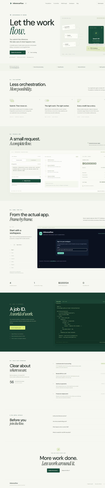
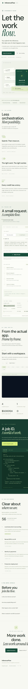
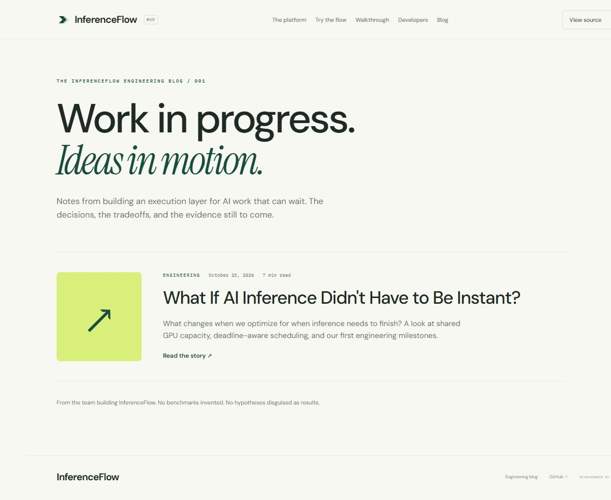
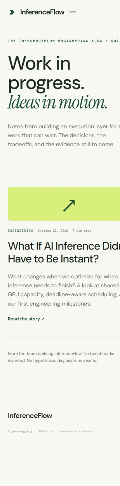
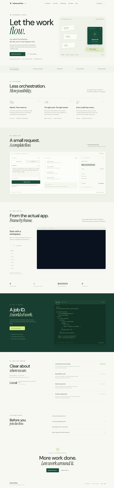
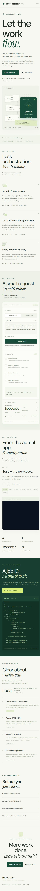

# Website validation — October 23, 2026

## Live scope and evidence

The existing owner-private Site was accessed in the authenticated in-app browser. Homepage → Blog → first article and article → blog → home were exercised through actual links. Desktop override was 1440×1000; one browser read reported a 1309px layout viewport due to the host's scaling. Mobile override was 390×844; the host initially reported a 354px effective layout viewport. Neither live layout reported horizontal page overflow. Prepared local fixes were separately checked at a reported 390px width. These are browser observations, not invented Lighthouse scores.

[Live homepage](https://inferenceflow-execution.abc123xyza.chatgpt.site/), [blog](https://inferenceflow-execution.abc123xyza.chatgpt.site/blog/), [article](https://inferenceflow-execution.abc123xyza.chatgpt.site/blog/what-if-ai-inference-didnt-have-to-be-instant/). Authenticated HTTP route/asset checks are in [live-http.json](live-http.json); the site is still private. All15 static assets, including every walkthrough image, returned200; see live-assets.json. robots.txt and sitemap.xml returned 404; neither was linked. Both SVGs loaded after scrolling; an unscrolled lazy image is not a broken image. Browser warn/error logs were empty in the tested interaction window. Network performance-entry inspection was unavailable in the browser's read-only evaluator; HTTP asset checks supplement, rather than replace, the interaction test. No claim of a complete HAR or automated WCAG certification is made.

## Issue register

| Issue | Severity | Evidence | Prepared fix | Verification |
|---|---|---|---|---|
| Missing homepage canonical / incomplete social metadata | Low | Live DOM has no canonical; article/index have one | Add HTTPS canonical, OG image/type and social card | Local DOM and static checks pass; NOT yet live |
| Low-contrast small labels | Medium | Live nav #747c70, hero note #8a9184 on cream; mobile hero note 7px, art footer 6px in observed styles | Darken relevant labels to #53634e; increase important small text | Prepared desktop/mobile screenshots; contrast calculation documented below; NOT yet live |
| Unversioned 56-test badge | Low | Live badge implies a current count without date/reference | Replace with durable local-pipeline status, point readers to repository | Prepared page shows updated status; NOT yet live |
| Prototype distinction below hero copy | Medium | Hero promises orchestration while mock disclosure is a small note | Explicit asynchronous background-workload prototype copy and development status | Local desktop/mobile render; NOT yet live |
| Premature closing language | Low | “Your next batch starts here” can imply live service | “Explore the development prototype”; source/replay links remain functional | Local DOM; NOT yet live |
| Mobile heading word boundary and keyboard diagram scroll | Low | Hidden br can join accessible heading text; diagram is horizontally scrollable | Add whitespace at br, focusable labeled diagram groups | Source/link checks; local article regression pass; NOT yet live |
| No explicit indexing policy | Low | robots/sitemap absent, access private | Prepare noindex/nofollow and robots Disallow; do not create public sitemap | Local metadata checks pass; requires publishing confirmation |
| Some diagram/art microtext remains small | Low | Decorative annotations and embedded SVG text | Keep full-size SVG links and mobile horizontal scrolling | Both live SVGs render; further readability/accessibility work remains |

Contrast calculations use WCAG relative luminance for opaque text on #f7f8f2. Live nav #747c70 is4.05:1 and hero note #8a9184 is3.04:1; prepared #53634e is6.03:1. This is a targeted improvement; translucent layers, all screenshots, every decorative label and every browser state have not received a full contrast audit. Main prose is readable; accessibility is not certified.

## Credibility review

The site clearly presents asynchronous queue → execution → usage accounting through an explicitly mock browser replay. The original “Let the work flow” headline alone does not state the product category. Prepared supporting copy now does. The workload section identifies document processing/classification/enrichment and distinguishes background work from chat latency. There is no live sign-up/buy CTA or unsupported savings/SLA claim. GitHub, guide and replay actions work. The engineering blog is a real first-party link. Prototype/private access should stay prominent; no public alpha launch is implied. Completion targets and pricing hypotheses belong in qualified engineering material, not a guaranteed price/latency promise. Recommend adding measured economics only after a reproducible real-GPU report and a reviewed private-alpha access flow.

## Article accuracy and completeness

The supplied Markdown is retained in sites/inferenceflow/content/first-engineering-post.md. Paragraph/list fidelity and all eight main headings pass the included test. The article covers asynchronous economics, interactive latency, compatible customer demand, deadline scheduling, utilization/cost hypotheses, the vLLM boundary, provider flexibility, potential scheduling/data advantages, actual measurements and current status. All six prohibited implications are explicitly qualified: no established lower costs, no 60-minute SLA, no completed GPU benchmark, no active Vast/Lambda production service, no proven moat, and no claim to invent continuous batching. No editorial rewrite was needed.

## Deployment source of truth

The live version is managed Sites source commit 809105c135da7388b49c5aa743693876d04b7724, published through the Sites source helper plus save_version_and_deploy_private. The selected checkout is `Playground/sites/inferenceflow-showcase`; `.openai/hosting.json` binds project appgprj_6adafd6c10c08191902e89c3c7c9febe with static.directory=dist. `sites/inferenceflow` in GitHub mirrors that source; pushing GitHub does NOT publish Sites. No framework build, dependency install or backend accompanies this static site. No second Site was created. Current fixes exist in both source directories and are deliberately UNPUBLISHED per this task's confirmation requirement. Existing unrelated console drafts were preserved and excluded from this change.

Page sizes: live homepage ~18.9 KB, index ~4.8 KB, article ~19.7 KB; main CSS 35.9 KB; main JS 10.7 KB; initial walkthrough image ~37 KB. Google-hosted fonts predate this task; they can still generate third-party font requests. No new analytics/tracking was added. No visible keys, tokens, actual customer prompts or private configuration were observed; fixtures and screenshots use synthetic development data. Authenticated private-site checks do not establish anonymous public access.

## Screenshots

### Live homepage

### Live blog

### Live article

### Prepared fixes — awaiting publication confirmation

