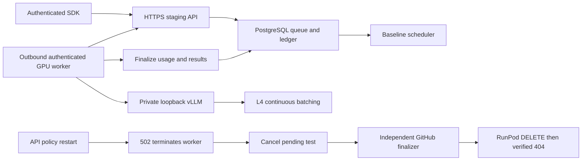
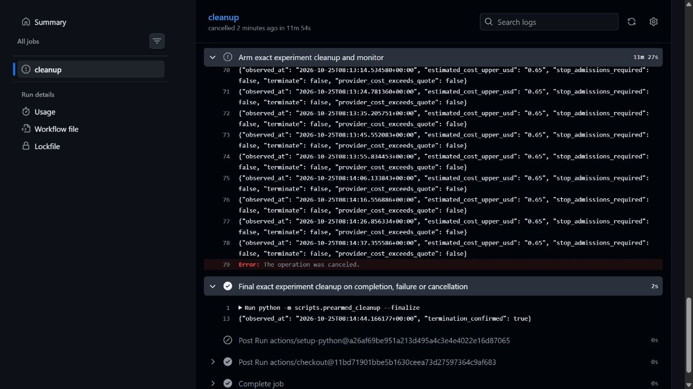

# First real GPU inference: baseline passed, recovery blocked

Executed October 25, 2026, 08:03–08:14 UTC. These are real rented-GPU results, not mock measurements. **NO-GO for public beta or an economic-advantage claim.** The basic execution/accounting pipeline passed; a transient control-plane outage killed the worker during preparation of the adaptive comparison. Testing stopped and the pod was terminated. No second inference pod was created.

## Resource, compatibility and safeguards

One explicitly authorized **NVIDIA L4 24 GB, Secure Cloud, US-MO-2**, pod `w70ukczutth1b4`. Live catalog stock was LOW. RunPod quoted $0.59/hour compute plus $0.011/hour for 80 GB ephemeral disk; displayed rounded total $0.60/hour. Independent guard ceiling $0.65/hour. No persistent, network or global volume; no exposed ports, SSH listener or public vLLM endpoint. The API, PostgreSQL and scheduler ran on the supervised local CPU host behind authenticated HTTPS. The GPU worker connected outbound with its scoped credential; it received no database, Stripe or provider key.

- Image: `vllm/vllm-openai@sha256:6cf9808ca8810fc6c3fd0451c2e7784fb224590d81f7db338e7eaf3c02a33d33`, verified vLLM 0.8.5.
- Model and tokenizer: `Qwen/Qwen3-4B`, revision `1cfa9a7208912126459214e8b04321603b3df60c`.
- BF16, V1 engine, thinking disabled, prefix caching disabled, context 10,240, `max_num_seqs=4`, GPU-memory fraction 0.85, loopback port 8000.
- Engine logs: weights 7.5552 GiB; KV cache 76,448 tokens; calculated engine capacity 7.47 full 10,240-token sequences. The four-slot configuration initialized and generated successfully. Four simultaneous maximum-length prompts were **not** stress-tested.
- Engine launch-to-health 165 seconds. Creation-to-health approximately 345 seconds, including the image pull and worker environment setup. The 1.27-second weight-loader observation excludes download, compilation and other startup work.
- Baseline flags: v2 false, adaptive false, tenant cap four. Adaptive preparation: both true, cap four, estimator uncalibrated. Automatic provisioning, public beta and Stripe remained disabled throughout. Wallet/rate/settlement implementation was unchanged.

The protected GitHub watchdog was armed at 08:03:16 UTC before creation at 08:03:43.438 UTC, then bound the exact marker/name. It had an $8 guard budget while reserving $2 of the original $10 for the prior teardown test/uncertainty, a 110-minute deadline and independent encrypted cleanup credentials. RunPod does not enforce this $10 experiment limit. The earlier teardown-only trial already proved the cleanup key could actually delete a live pod.

## Workload and measurements

The existing deterministic workload alternates one medium record per five requests with short records. It asks for two-sentence synthetic logistics summaries, temperature 0, top-p 1, output limits 256/128. Records differ by index; the same indexed content is reproducible across policies. Inputs are roughly 237–863 actual tokens; real output is shorter than its limit. This does **not** characterize long generation, document extraction accuracy or a mixed production population.

| Stage | Accepted / successful | API acceptance → last terminal | Request p50 / p95 / p99 | Input / output tokens | 60-minute successful attainment |
|---|---:|---:|---|---:|---:|
| Baseline 10 | 10 / 10 | 7.980 s | 5.702 / 7.980 / 7.980 s | 3,618 / 352 | 100% |
| Baseline 100 | 100 / 100 | 71.294 s | 37.279 / 68.193 / 71.185 s | 36,270 / 3,461 | 100% |
| Adaptive 100 | 100 / 0 | Canceled after 145.383 s | No successful latency | 0 / 0 | 0% |
| Sequential; 1,000 requests; deliberate interruption | Not run | — | — | — | Unknown |

Latency is submission-to-result, including queue time; successful-only percentiles are not model service-time percentiles. Baseline-100 submission-to-first-dispatch p50/p95/p99 was 35.200/65.871/69.101 seconds. Over its 71.294-second job window, throughput was **508.74 input tokens/s and 48.55 successful output tokens/s**. Loader wall time was 80.703 seconds, including validation/polling/results/journal reads: 449.43 input and 42.89 output tokens/s. These distinct denominators must not be mixed.

Across the entire attempt, 110 of 210 accepted requests succeeded: **52.38% actual successful completion within 60 minutes**, counting the 100 canceled requests in the denominator. All successful baseline requests met their requested one-hour targets. There is no measured 1,000-request completion result, sustained sub-hour guarantee or matched sequential/adaptive speedup.

## Continuous batching and observability

Worker telemetry recorded peak HTTP overlap four; vLLM samples independently recorded **four active sequences**, establishing concurrent engine execution on this workload. Existing continuous batching is active. This evidence does not establish a speedup against sequential execution or justify an additional application microbatcher.

Before failure the worker reported 110 completed calls, zero engine-call errors, 47.515 seconds with overlapping calls and 160.178 summed request-seconds during 156.048 observed seconds. HTTP-idle time was 100.387 seconds; therefore mean HTTP concurrency during non-idle time was about 2.88. These are worker HTTP observations, **not GPU utilization or batching-efficiency percentages**. Control-plane gaps and queue dispatch contribute idle time.

The one-second collector wrote raw Prometheus/NVIDIA samples to ephemeral disk and stdout. Provider logs split long JSON messages into 16 KiB fragments; bounded retrieval also omitted intervals. Reconstruction yielded **52 valid samples** from 08:09:31.987 to 08:11:31.913 UTC with gaps; eight incomplete messages and two invalid Prometheus messages were excluded. Sample-weighted GPU utilization was **64.90%**, peak 100%; peak engine waiting queue zero in these samples. This coverage mainly reflects baseline load. Full startup/idle/failure-inclusive time-weighted GPU utilization and decode-only batching efficiency remain **unknown**. Do not label the sample mean as full-experiment utilization. Iteration-token histograms include prefill, so tokens/iteration is not pure decode batch size.

Sanitized [machine-readable evidence](real-gpu-evidence/summary.json), [engine samples](real-gpu-evidence/engine-samples.json), and stage audits are retained here. Raw receipts, prompts/results, private environment, worker credential and full logs remain outside Git in ignored local evidence storage. Improve compact, durable telemetry export before another experiment; do not spend to recover missing samples.

## Failure and customer accounting



At 08:12:13 UTC the worker's poll received HTTP 502 while the staging API was being restarted to apply adaptive flags. `apps/worker/main.py` raised from `raise_for_status()` and exited. Its launcher stopped vLLM. RunPod restarted the container, but bootstrap failed repeatedly with `remote origin already exists` because it reused the existing checkout. This exposed two recovery blockers: transient poll/heartbeat errors lack bounded reconnect/re-registration, and bootstrap is not restart-idempotent. These are observed failure paths; adaptive policy itself was **not** benchmarked or proven defective.

The loader's pre-submission worker check briefly saw an earlier fresh heartbeat, so it accepted the adaptive job despite the worker having just exited. The job then remained queued. The operator detected stale telemetry, stopped testing, canceled that job through the existing customer API, and triggered cleanup. This is a freshness-race/recovery limitation, not a successful interruption-recovery test. No product features or billing implementation were changed during the experiment.

Read-only PostgreSQL audits passed for both baseline stages: **110 unique usage records, 110 unique capture sources, zero retries, zero reconciliation drift**, captured 5,198 micro-USD of synthetic test credit. The canceled arm captured zero, released its entire 8,320-micro-USD reservation and left zero reserved funds. Its audit intentionally fails the real-execution assertion (`non_real_or_missing_attempts`): it has no execution attempts or usage records. Zero-value terminal capture sources are not paid inference. Existing synthetic credit is not revenue or RunPod credit. Exactly-once billing passed for successful baseline execution; exactly-once settlement **after worker interruption remains unvalidated on GPU**.

## Spend, economics and decision

Creation-to-confirmed-absence upper bound: **660.728 seconds**. Including startup, idle, unsuccessful-arm time, cleanup and disk, quoted-rate provider cost is **$0.110305 estimated**; at the conservative ceiling it is $0.119298. Final billing API returned no posted records at report time, so actual invoice cost is **unknown**, not zero. Console credit changed from $9.99 before this pod to **$9.88** afterward; the account had originally $10 and the previous teardown-only test also consumed credit. The balance delta is corroboration, not a line-item invoice.

The real successful workload produced **39,888 input and 3,813 output tokens**. Full rented-lifetime provider cost per million successful output tokens is **$28.93 estimated**, charging all compute/disk time to successful output. Including the earlier teardown trial's approximately $0.00756 estimate gives about $30.91/M output for both trials combined. These are not separate input/output customer prices. The 100-request warm window alone implies about $3.44/M output at $0.601/hour, excluding cold/idle/failure overhead. Paid CPU hosting, operations, taxes and payment processing were not established as zero; commercial fully loaded cost and margin remain unknown. Do not treat local CPU hosting as sustainably free.

Hosted sources checked October 25: [Together AI pricing](https://www.together.ai/pricing) does not list an exact pinned Qwen3-4B equivalent in the retrieved table. Its Qwen2.5-7B Instruct Turbo quote is $0.30 input/$0.30 output per million tokens; Qwen3.5-9B is $0.17/$0.25. [AWS's Qwen catalog](https://docs.aws.amazon.com/bedrock/latest/userguide/model-cards-qwen.html) also lacks Qwen3-4B. [Bedrock pricing](https://aws.amazon.com/bedrock/pricing/) lists Qwen3-32B in Sydney at $0.1545/$0.618 standard and $0.0773/$0.309 batch. These are **different models, revisions, sizes, possibly precision/tokenization and service guarantees**. No hosted calls, quality comparison or like-for-like savings claim was made.

Illustrative sensitivity only: with baseline-100 input/output ratio 10.48 and its observed 48.55 output tokens/s, Together's different Qwen2.5-7B token prices imply roughly $3.44/M output-equivalent, requiring essentially continuous warm utilization merely to approach parity before overhead. The different Qwen3.5-9B prices imply about $2.03/M output-equivalent: break-even needs about 82 output tokens/s, above this observed platform rate even without idle time. Thus increasing volume alone has **not** demonstrated an economic advantage at this configuration. Output length, quality and a true equivalent provider quote could materially change the comparison; 100 requests are not a saturation benchmark.

**Recommendation:** NO-GO for general asynchronous inference launch, savings marketing or automatic provisioning. Conditional GO for another separately authorized engineering validation after reconnect/bootstrap robustness and telemetry export are fixed and tested locally. Prefer exploring a narrower auditable document-extraction customer problem with explicit quality/evidence requirements over competing solely on cheap general tokens; extraction quality and willingness to pay were not tested here. Do not implement that product expansion as part of this experiment.

Repository still has no root LICENSE. Consider Apache-2.0 if permissive commercial adoption with an explicit patent grant is intended; consider a commercial/source-available approach if restriction is intended. **No license was selected or applied.** Owner approval and appropriate legal review are required before choosing terms.

## Teardown and next run

The [independent watchdog run](https://github.com/manishklach/InferenceFlow/actions/runs/40174806205) was canceled intentionally after the critical failure. Its always-run finalizer succeeded at **08:14:44.166 UTC**, logging `termination_confirmed:true`. A separate RunPod GET returned 404; pod inventory and network/global-volume inventories were empty. No backup deletion was needed. Overall workflow conclusion `cancelled` is expected; the final cleanup step succeeded. The watchdog is finished and unarmed.



Before any next paid pod: fix and locally test reconnect/re-registration and restart-idempotent bootstrap; prevent policy changes from dropping the live worker; retain durable compact telemetry and validate fragment handling; run the cancellation/recovery drills; refresh balance/stock/all-in quote; present the remaining budget; obtain authorization for exactly one new pod; arm a fresh independent watchdog and verify heartbeat. Existing temporary staging URLs/worker credentials must be revalidated securely rather than copied from public docs.

The existing test commands remain, with credentials supplied securely through environment variables (never command-line arguments or Git):

```bash
python -m scripts.gpu_experiment run --execute --policy baseline --count 10 --run-id UNIQUE --output PRIVATE_NEW_DIRECTORY
python -m scripts.gpu_experiment run --execute --policy baseline --count 100 --run-id UNIQUE --output PRIVATE_NEW_DIRECTORY
# Only after idle-safe adaptive configuration, fresh worker confirmation and prior passes:
python -m scripts.gpu_experiment run --execute --policy adaptive --count 100 --run-id UNIQUE --output PRIVATE_NEW_DIRECTORY
# 1,000 requests, sequential comparison and the opt-in interruption remain gated.
python -m scripts.audit_gpu_run --run-directory PRIVATE_RUN --output PRIVATE_NEW_AUDIT.json
python -m packages.common.cli reconcile
```

This report records an incomplete experiment honestly. It does not authorize another resource, change billing, enable public beta or establish an SLA.

Post-experiment local validation: nine experiment-tool unit tests passed; the staging wallet reconciliation returned zero drift. No new application implementation was introduced. The isolated staging services and temporary HTTPS tunnel were shut down after collecting evidence; the public Sites website is unaffected. Restarting staging requires fresh endpoint/authentication checks before another experiment.
