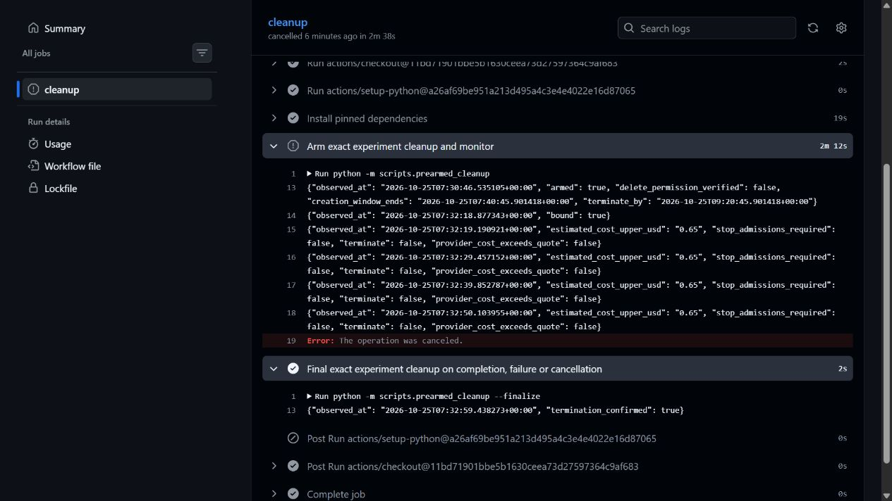

# Live RunPod teardown validation — passed

**One separately approved teardown-only pod was created and removed by the
independent GitHub cleanup path. No inference pod is authorized or running.**

The operator explicitly approved the ordering exception and then creation and
termination of exactly one L4 validation pod. This test used a $2 contingency
within the existing $10 overall experiment budget, with a $0.65/hour all-in
admission ceiling. It did not authorize the actual inference experiment.

## Actual resource and sequence

| Field | Observed evidence |
|---|---|
| Pod ID | `3benkmzk749x9u` |
| GPU / tier / data center | One NVIDIA L4, Secure Cloud, US-MO-2 |
| Provider pod hourly `cost` | $0.59; disk is accounted separately in planning |
| Disk / mounts / public ports | 80 GB ephemeral / `{}` / `[]` |
| Host allocation reported by provider | 94 GB system RAM, 16 vCPUs; not GPU VRAM |
| Container | Existing pinned vLLM image; entrypoint overridden to `/bin/bash -lc`, command `sleep 7200` |
| Workload / credentials | No vLLM server, model loading, inference, worker, database or provider credentials |

The image read-back matched
`vllm/vllm-openai@sha256:6cf9808ca8810fc6c3fd0451c2e7784fb224590d81f7db338e7eaf3c02a33d33`.
The live provider read confirmed exact ID/name, experiment marker, creation time,
L4/count/tier, image/command, disk, empty ports and no mounts. SSH, Jupyter and
global networking were disabled. No template or paid persistent volume was created.

Times below are **PDT, 2026-10-25**:

| Event | Time |
|---|---|
| Independent runner authenticated and emitted `armed:true` | 00:30:46.535 |
| Actual provider creation timestamp | 00:32:14.150 |
| Independent runner emitted `bound:true` | 00:32:18.877 |
| Final cleanup step began after requested workflow cancellation | 00:32:57.986 |
| Runner reported `termination_confirmed:true` | 00:32:59.438 |

The runner's ten-minute creation window was open before the create. Only one
create call was made; no ambiguous retry or substitute GPU was used. After the
runner bound the exact resource, the workflow was deliberately cancelled to
exercise cancellation cleanup. The monitor step was cancelled as expected, and
the final `always()` cleanup step completed **successfully**. The workflow's
overall conclusion is `cancelled`, not a failed application test.

[Live GitHub run and logs](https://github.com/manishklach/InferenceFlow/actions/runs/40172971408)
record arming, binding and confirmed termination. The reviewed cleanup code
checks the exact resource before DELETE and requires a fresh GET returning 404.
No backup deletion through the RunPod connector or operator console was used.

An independent RunPod connector `get_pod` then returned **404: pod not found**.
Complete `list_pods`, `list_network_volumes` and `list_global_volumes` reads all
returned empty inventories. This validates live pod termination through the
protected GitHub cleanup credential and cancellation/finalization path. It does
not imply every failure mode or future credential remains safe indefinitely.

## Cost evidence: estimate versus posted billing

The refreshed console quote showed GPU $0.59/hour and ephemeral disk
$0.011/hour, with a rounded displayed total $0.60/hour. Its displayed components
sum to $0.601/hour, below the approved $0.65 ceiling.

Creation to runner-confirmed absence took at most **45.288 seconds**. The exact
provider deletion/billing-stop timestamp was not returned. Applying the quoted
component rate to that upper duration gives approximately **$0.00756**, or
**$0.00818 at the conservative $0.65/hour ceiling**. These are estimates, not an
invoice or a claim of measured final cost.

The initial post-cleanup per-pod and aggregate billing reads for the 07:00–08:00
UTC bucket returned **no records**. The refreshed console still displayed
**$10.00** credit. Billing is therefore **pending**, not proven free or $0 actual
spend. Refresh this exact pod's billing before reconciling the combined experiment
budget; retain the $2 contingency reservation until the provider posts charges.
No storage was left attached and no resource remains to continue this pod's billing.

## Scope of validation and next gate

The staging database still has **zero jobs and zero requests**. Its only ledger
entry is the previously documented synthetic opening top-up; there were no
usage captures and reconciliation returned `drift: []`. No customer wallet or
billing implementation changed during the teardown test.

**Validated live:** independent runner readiness before create, exact-resource
binding, cleanup credential pod-management authority, requested-cancellation
cleanup, fresh disappearance confirmation and absence of leftover volumes.

**Not validated live:** the automatic 110-minute timer, cost-threshold termination,
runner/provider outage recovery, GPU kernel/model/VRAM compatibility, inference
throughput, GPU utilization, continuous batching, latency, deadline attainment,
worker-interruption recovery or exactly-once usage capture during real inference.
The existing deterministic tests cover several guard decisions; this report does
not turn those simulations into live measurements.

The next step is a **new, separately approved inference pod** with a fresh
experiment marker and newly armed guard. Refresh available GPU/placement and
full pricing, posted teardown charges/balance and remaining budget first. The
real-mode CPU staging is prepared, but its local supervisor expires at 03:58 PDT
today and worker tokens require restart/re-registration before their one-hour
expiry. Use only the separate synthetic test tenant and preserve billing logic.

**GO to request approval for a real inference experiment; no approval to create
it yet. No economic or sub-hour performance GO recommendation is established.**
