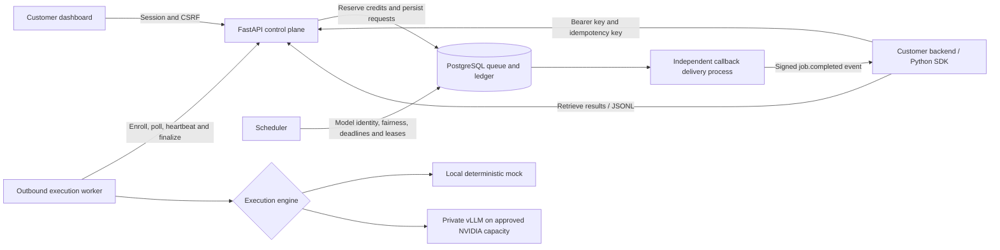

# InferenceFlow: integration and execution walkthrough

This is a recording of the working platform using **real HTTP requests, PostgreSQL, scheduler and worker processes, and synthetic mock inference**. It covers sign-in, prepaid admission, queueing, execution, result retrieval, metering, settlement, SDK integration, idempotency and cancellation.

The recorded run used $10 of seeded development credit, not a payment. No GPU was rented, no Stripe call was made, and no real model output is claimed. A deliberate ten-second mock delay makes the running state visible; it is not a performance measurement. Published assets contain synthetic data, truncated key prefixes and public job metadata. Full credentials and private runtime configuration are excluded; the demo SDK key was revoked on shutdown.

[Open the screenshot player](https://inferenceflow-execution.abc123xyza.chatgpt.site/#walkthrough) · [Execution evidence JSON](https://inferenceflow-execution.abc123xyza.chatgpt.site/assets/walkthrough/execution-evidence.json) · [Actual SDK JSONL results](https://inferenceflow-execution.abc123xyza.chatgpt.site/assets/walkthrough/sdk-results.jsonl)

## 1. How an application integrates

Your application keeps its API key on its backend, submits a batch with an idempotency key, stores the returned job ID, and retrieves results by polling or reacting to a signed callback. The dashboard offers the same submission, history, results and wallet views through a CSRF-protected browser session.



| Component | Responsibility | Code |
|---|---|---|
| Customer API | Authenticate, isolate tenants, validate batches, reserve credit, expose results | `apps/api/main.py` |
| Durable queue and accounting | Transactional job/request state, immutable rate snapshots, reservations and journal | `packages/common/db.py`, `packages/common/service.py` |
| Scheduler | Matching model affinity, tenant fairness/concurrency, deadline expiry, retry/recovery | `apps/scheduler/main.py`, `service.schedule` |
| Worker | Outbound enrollment, generation/epoch fencing, active-lease renewal, inference and finalization | `apps/worker/main.py` |
| Engine adapter | Deterministic local output or private vLLM requests with identity checks | `apps/worker/engines.py` |
| Callback delivery | Claim events, sign and retry delivery outside the scheduler and DB transactions | `apps/callbacks/main.py`, `packages/common/webhooks.py` |
| Provider adapter/watchdog | Explicitly enabled capacity operations and independent leak/budget reconciliation | `packages/common/providers.py`, `apps/scheduler/watchdog.py` |
| Customer SDK | Submission, retry/idempotency, status polling, results and cancellation | `packages/python_sdk/client.py` |

### Python integration

Install the SDK from this repository (`pip install -e .`). Create an API key in the dashboard, store it in your backend's secret environment, and use it as follows. Do not embed keys in browser JavaScript or source control.

```python
import os
from packages.python_sdk import InferenceFlowClient

with InferenceFlowClient(
    os.environ["INFERENCEFLOW_API_KEY"],
    os.environ.get("INFERENCEFLOW_BASE_URL", "http://localhost:8080"),
) as client:
    job = client.create_job(
        requests=[{
            "custom_id": "document-001",
            "messages": [{"role": "user", "content": "Summarize this document..."}],
            "max_output_tokens": 128,
        }],
        idempotency_key="customer-import-2026-001",  # Persist/reuse for this exact submission.
    )
    print(job["id"], job["status"], job["reserved_micro_usd"])
    completed = client.wait_for_job(job["id"], timeout=300)
    results = client.get_results(job["id"])
    print(completed["captured_micro_usd"], results["items"])
```

Reusing that key with the same payload returns the same job; a different payload returns 409. The API returns 202 before inference finishes. Results remain tenant-scoped. For large batches, paginate results or download `GET /v1/jobs/{id}/results.jsonl` using the same authentication. `billing_pending` requires reviewed usage reconciliation rather than a guessed charge.

## 2. Recorded dashboard flow

### Sign in

The demo uses a synthetic local email. Production replaces local email login with the managed OIDC authorization-code/PKCE flow.


### Fund the development workspace

The runner seeds 10,000,000 microUSD ($10) into a separate walkthrough database. There are no jobs and no reserved funds. The API-access panel displays only a key prefix. The Stripe buttons are present but their integration remains disabled for this recording.


### Submit and reserve

Clicking **Queue sample job** submits one request through the real API. The worker is intentionally paused, so the request remains queued. Admission reserves **54 microUSD**: available credit becomes $9.999946, reserved credit becomes $0.000054, and the charge is still zero.


### Lease and execute

Starting the worker enrolls its exact model identity and a fresh generation. The scheduler leases compatible work; poll changes it to running. Heartbeats report the active request ID/epoch. The mock adapter deliberately waits ten seconds so this transition can be observed.


### Meter and settle

The worker finalizes output and usage through the API. The request succeeds with **150 synthetic input units and 69 synthetic output units**. Settlement captures **36 microUSD**, releases **18 microUSD**, and returns the reservation to zero. The resulting available balance is $9.999964.


These are mock byte-based usage counts, not validated Qwen token counts. At the synthetic rates (100,000 input and 300,000 output microUSD per million units), the integer calculation is:

```text
Reservation = ceil(150 × 100000 / 1000000) + ceil(128 × 300000 / 1000000)
            = 15 + 39 = 54 microUSD
Actual charge = ceil(150 × 100000 / 1000000) + ceil(69 × 300000 / 1000000)
              = 15 + 21 = 36 microUSD
Unused reservation released = 54 - 36 = 18 microUSD
```

### Retrieve output

The **Results** button fetches the authenticated results endpoint. The response contains ordered `custom_id`, output, status, usage, charge, completion and pagination fields. `MOCK ...` is intentionally visible; this is not a generated natural-language summary. This later screenshot also includes the SDK jobs described next.


### Verify SDK integration and accounting

The real Python SDK then submits a three-request batch, replays the same idempotency key, waits for completion, retrieves JSON and JSONL, and cancels a separate unstarted job. The final dashboard shows two successful jobs and one canceled job.


| Observation | Recorded result |
|---|---:|
| Initial seeded credit | 10,000,000 microUSD |
| Dashboard request completed | 1 |
| Dashboard request charge | 36 microUSD |
| SDK requests completed | 3 |
| SDK batch charge | 88 microUSD |
| Idempotent replay | Same job ID; no extra job/reservation |
| Canceled request charge | 0 |
| Total capture | 124 microUSD ($0.000124) |
| Final available balance | 9,999,876 microUSD ($9.999876) |
| Remaining reserved / debt | 0 / 0 |
| Reconciliation drift | None |

The evidence file includes real job IDs, request attempts/epochs, model identity, per-request reservation/capture/release, result bodies, and ledger entries. It is the source for these numbers. The initial reservation, capture and release are separate journal entries; releasing a canceled reservation does not create a customer charge.

## 3. What happens between submission and settlement

```mermaid
sequenceDiagram
    participant C as Customer / SDK
    participant A as API
    participant D as PostgreSQL
    participant S as Scheduler
    participant W as Worker
    participant E as Mock or private vLLM
    C->>A: POST /v1/jobs + auth + Idempotency-Key
    A->>D: Validate funding, snapshot identity/rates, reserve, queue
    A-->>C: 202 + job ID
    S->>D: Claim compatible requests; lease epoch and worker generation
    W->>A: Poll with available physical slots
    A->>D: leased → running
    A-->>W: Payload + identity + epoch
    W->>E: Execute messages and output limit
    W->>A: Heartbeat with active request epochs
    E-->>W: Output + measured usage
    W->>A: Finalize output/usage with epoch
    A->>D: Fence stale attempts; persist output/usage; capture/release once
    C->>A: GET status and results / JSONL
    A-->>C: Output + usage + actual charge
    Note over D,S: Separate callback process enqueues/delivers signed completion events
```

Execution is at least once: physical inference may repeat after a crash. Accounting uses fenced finalization and unique journal/usage records to prevent duplicate capture. An abandoned lease is recovered with bounded attempts/backoff; a restarted worker cannot keep a previous generation alive. Deadline targets are best effort: unstarted expired work is released, while already-running work may finish late. A regular cancellation can still permit running completion and billing; a verified funding reversal instead freezes the tenant and cancels/fences outstanding work.

## 4. Switching from local mock to real integrations

These are integration instructions, not actions performed in the recording.

| Integration | Production execution path | What still needs external validation |
|---|---|---|
| Identity | Configure managed OIDC, HTTPS callback, issuer/audience/JWKS and client; local login is disabled outside development | Actual identity-provider login/session lifecycle |
| Funding | Configure **Stripe test credentials only**, beta gate and signed API-origin webhook; paid session credits the ledger | Test checkout, delayed/duplicate events, refunds/disputes; live payments remain rejected |
| GPU | With explicit spending approval, attach rented NVIDIA capacity; run pinned vLLM and outbound worker per [GPU deployment](https://github.com/manishklach/inferenceflow/blob/codex/execution-walkthrough/docs/gpu-deploy.md) | Image/flags, VRAM, tokenizer agreement, OOM/restart, measured throughput/cost |
| Scheduling | Workers advertise repository, model/tokenizer SHA, execution mode and capacity; scheduler dispatches matching queued work | Real utilization tuning and workload fairness under load |
| Metering | vLLM returns usage; the API checks it against admission bounds, captures actual usage and releases unused funds | Real model token agreement and margin/provider invoice checks |
| Callbacks | Register a public HTTPS destination; preserve its one-time secret; verify timestamp and HMAC over raw body; deduplicate event ID and fetch results | Actual HTTPS/egress behavior and retry delivery |
| Capacity safety | Run the independent watchdog with scoped provider access; enforce configured instance/session/daily estimates | Provider inventory/create/delete behavior and provider-side spend controls |
| Operations | Separate service secrets, private DB/vLLM, restricted internal/metrics routes, supervised callbacks and alerting | Deployment ingress, backup restoration and alert delivery |

The current scheduler dispatches onto enrolled capacity; it does **not** autonomously rent a GPU when a customer submits a job. The modular provider adapter supports operator-controlled operations, but a created instance still needs the prepared vLLM/worker startup path. Keep `PROVISIONING_ENABLED=false` until a specifically approved, capped exercise. Future AMD/provider integrations can implement the provider/engine interfaces without changing the customer submission contract.

GPU topology: customer traffic reaches the HTTPS CPU control plane; PostgreSQL remains private; the GPU worker initiates outbound calls to the control plane and talks to vLLM on GPU-host loopback. The GPU host needs its enrollment/engine credentials and model configuration, not database, Stripe, provider or control-plane encryption secrets. The revision-derived engine alias checks configured identity; it is not hardware attestation.

Stripe sends its signature-verified webhook to `/internal/stripe/webhook` at the API origin. The dashboard proxy intentionally excludes internal and metrics routes. A redirect back from Checkout is not evidence of payment and never grants credits by itself. Customer callbacks are also independent from Stripe callbacks and carry job metadata rather than inference output.

## 5. Reproduce the recording locally

Use a **local development** PostgreSQL connection in `.env`, Python 3.11/3.12, Node 22 and installed dependencies. The walkthrough uses API port 8091, dashboard port 3001 and a database named `<DATABASE_URL database>_walkthrough`. Existing API/dashboard ports 8080/3000 are left alone. Never point this helper at a production database server.

```bash
python -m pip install -e '.[dev]'
cd apps/dashboard
npm ci
cd ../..
python scripts/walkthrough.py serve
```

If the application role lacks `CREATEDB`, have a local administrator pre-create the dedicated database owned by that role and allow the role to connect. For the default database/role names, the administrator can use:

```bash
createdb --username=postgres --owner=inferenceflow inferenceflow_walkthrough
```

This may require local peer/admin authentication and a narrowly scoped PostgreSQL connection rule for your host. Do not grant the application role broad database administration permissions just to run a demo. The helper can create the dedicated database if the local development account already has that right; it never truncates or drops it.

1. Open the printed `http://127.0.0.1:3001` URL and sign in with the printed synthetic email. Wait for the page to load; first compilation may take a few seconds. Using `127.0.0.1` also separates its session cookie from an existing `localhost:3000` workspace.
2. Enter a synthetic prompt and click **Queue sample job**. Capture the queued/reserved state before enabling the worker.
3. In a second terminal run `python scripts/walkthrough.py execute`. Observe running and then succeeded; the mock adapter waits ten seconds per request for visibility.
4. Click **Results**, expand **Credit and usage ledger**, and capture those states.
5. Run `python scripts/walkthrough.py verify` once for this session. It checks a three-request SDK batch, idempotent replay, cancellation, JSONL, reservation release and database reconciliation. Its output and private service logs are under ignored `.runtime/walkthrough/`.
6. Optionally run `python scripts/walkthrough.py publish` to copy only the whitelisted synthetic evidence/JSONL into `docs/media/walkthrough/`. Take screenshots through the browser, and never publish private state or raw service logs.
7. Stop with `python scripts/walkthrough.py stop` or Ctrl+C in the serving terminal. Only this helper's processes are terminated; its SDK key is revoked. The dedicated database is retained for inspection. Next.js may regenerate its type/config files for the separate `.next-walkthrough` build directory; review those generated changes before committing.

The seven committed JPEGs are unaltered browser captures. The player offers sequential navigation through them; it is a screenshot recording rather than a continuous video. To view it locally:

```bash
python -m http.server 8092 --bind 127.0.0.1 --directory docs
# Open http://127.0.0.1:8092/walkthrough.html
```

## 6. Validation and boundaries

The recording exercised the real local API, durable queue, scheduler, outbound worker, result endpoints, SDK, metering and ledger. Its five requests comprise four completed requests and one canceled request. The worker was deliberately paused and its mock latency increased solely for recording. The separate callback process ran, but no destination was registered or contacted.

Validation after adding the recording support: 56 automated tests passed, with the real-GPU test skipped; Ruff, mypy and the dashboard production build passed. The reproduction helper was also exercised end to end in a second fresh synthetic workspace, including cleanup and credential revocation. Screenshot-player navigation and automatic playback were checked in the browser. Local documentation links, accounting totals and credential exclusion were verified. The second validation run did not overwrite the published recording or its job IDs.

No OIDC provider, Stripe account, provider API, rented GPU or real vLLM model was used. Those paths remain gated and require credentials, explicit GPU spending approval where applicable, and the validation described in [GPU deployment](https://github.com/manishklach/inferenceflow/blob/codex/execution-walkthrough/docs/gpu-deploy.md), [operations](https://github.com/manishklach/inferenceflow/blob/codex/execution-walkthrough/docs/ops.md), and the [audit remediation guide](https://github.com/manishklach/inferenceflow/blob/codex/execution-walkthrough/docs/audits/2026-10-22-remediation.md).
